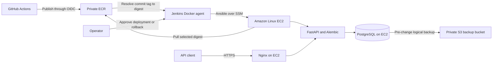

# Ticket-API

A FastAPI service for managing tickets and incidents. PostgreSQL stores the
application data. GitHub Actions tests and publishes the container image, and
Jenkins deploys an approved release to Amazon EC2 through Ansible and AWS
Systems Manager.

[](https://github.com/Orlando-Alvarez/Ticket-API/actions/workflows/ci.yml)
[Swagger UI](https://api.orlandoalvarez.dev/docs) · [ReDoc](https://api.orlandoalvarez.dev/redoc)

## Engineering Highlights

- The versioned REST API uses JWT authentication, Argon2 password hashing, and
  role- and resource-level authorization for users, tickets, and incidents.
- PostgreSQL constraints and Alembic migrations support audited soft deletion.
  Application tests cover authorization, resource scoping, and readiness.
- GitHub Actions gates image publication on Ruff, application tests,
  PostgreSQL integration tests, and a Docker build. It uses GitHub OIDC to
  publish immutable commit tags to private ECR.
- Jenkins resolves the requested commit to an ECR digest and requires approval
  before deploying. The deployment and rollback jobs share a lock, back up
  PostgreSQL, and verify the deployed digest, container health, and readiness.
- Deployment failure diagnostics capture the observed EC2 state for the
  operator. Infrastructure and deployment use Terraform and Ansible,
  respectively, with SSM in place of public SSH.

## Implementation Status

| Capability | Status |
| --- | --- |
| Backend, PostgreSQL, migrations, and Compose | Implemented and covered by application and integration tests |
| CI and main-branch ECR publication | Verified in [GitHub Actions](https://github.com/Orlando-Alvarez/Ticket-API/actions/runs/44975797065) |
| Jenkins delivery to EC2 and controlled image rollback | Implemented. Successful deployment and rollback reported by the operator |
| PostgreSQL backup and restore | Pre-change S3 backups implemented. Archive validation, upload verification, and one isolated manual restore reported by the operator |
| Recovery diagnostics and shared locking | Implemented and exercised in operator-reported failure simulations and concurrent-job tests |
| Renewable workload identity, scheduled backups, and observability | Planned |

See [Testing and Validation](docs/testing.md#operator-verified-delivery-evidence)
for historical results. Review the
[rollback preflight issue](docs/jenkins.md#controlled-rollback) before running
the current checkout.

## Architecture



Terraform provisions the AWS network, EC2, IAM, ECR, S3, and KMS. The
application and migration containers use the selected image. Cloudflare
provides DNS and Nginx terminates HTTPS on the instance. The database uses a
Docker volume on the same host. See [Architecture](docs/architecture.md).

| Responsibility | Stack |
| --- | --- |
| API and access control | Python 3.11+, FastAPI, Pydantic, Uvicorn, PyJWT, Argon2 |
| Persistence | PostgreSQL 16, SQLAlchemy 2, Alembic |
| Runtime and edge | Docker, Docker Compose, Nginx, Cloudflare DNS, Certbot |
| Infrastructure and deployment | AWS, Terraform, Ansible, Systems Manager |
| CI, delivery, and testing | GitHub Actions, Jenkins, Pytest, Ruff |

## API and Local Quick Start

Routes live under `/api/v1`. Register a requester at `POST /users`, exchange
credentials at `POST /auth/token`, and send the resulting Bearer token on
protected requests. User, ticket, and incident routes enforce role and
resource ownership rules. Ticket and incident deletes are admin-only soft
deletes. Incident lists support status and severity filters and pagination.
`GET /health` reports liveness and `GET /health/ready` checks PostgreSQL.

Install Git and Docker with Compose v2.24.4 or later. Clone the repository, copy
`.env.example` to `.env`, and set local PostgreSQL values and a unique
`JWT_SECRET_KEY`. Use `cp .env.example .env` in Bash or
`Copy-Item .env.example .env` in PowerShell.

```bash
docker compose up -d --build
docker compose ps -a
```

Compose runs the one-shot Alembic migration service before the API starts.
Open [local Swagger UI](http://127.0.0.1:8080/docs) or check
[local readiness](http://127.0.0.1:8080/api/v1/health/ready). Use
`docker compose down` to stop the stack and preserve the database volume.
`docker compose down -v` deletes that volume. See
[Local Development](docs/local-development.md#authentication-example) for
authentication commands and direct Python setup.

## Continuous Integration and Delivery

GitHub Actions validates pull requests targeting `main` and pushes to `main`
and `feat/**`. Application and PostgreSQL jobs gate the Docker build.
Publication runs after the build on pushes to `main` and builds its own
image for the immutable `sha-<commit>` tag.

The deployment job takes `RELEASE_SHA`, verifies its ancestry on `main`, and
deploys the registry digest after manual approval. Jenkins uses the published
image without rebuilding it. The rollback job takes `CURRENT_SHA` and
`ROLLBACK_SHA`, checks Git history, compatibility, and the current EC2 image,
then requires approval before applying the target digest. Ubuntu WSL remains
an authorized operator alternative. See
[CI and Delivery](docs/ci-cd.md) and [Jenkins Operations](docs/jenkins.md).

## Backup and Recovery

Both jobs create a custom-format PostgreSQL dump before changing the
application. The EC2 role uploads it to an encrypted, versioned S3 backup
bucket. The playbook checks the archive catalog, object size, and encryption
metadata. An isolated manual restore provides separate evidence that a dump
can be restored. The image rollback leaves the database and migration history
in place.

On a deployment failure after the mutation phase begins, Jenkins attempts a
read-only inspection and archives a recovery report. The operator decides
whether to retry, use the rollback job, or investigate database recovery.
See [Backup and Restore](docs/backup-and-restore.md) and
[Disaster Recovery](docs/disaster-recovery.md).

## Security and Operational Limits

GitHub, Jenkins, the operator, and EC2 use separate AWS identities. Jenkins
uses an interactive temporary source session to assume a bounded deployment
role. EC2 pulls images, reads scoped KMS-protected parameters, and uploads
backups using its instance role. Jenkins approvals and artifacts should be
restricted to authorized operators. Keep logs, backups, and credentials out
of public build evidence. See [Security](docs/security.md).

The current topology has one EC2 host. Jenkins selects an image digest
but applies the deployment configuration from its SCM checkout.
Cross-job locking coordinates Jenkins jobs on the same controller. WSL
and other tools require separate operator coordination.

## Testing

Install the testing extra with `python -m pip install -e ".[test]"` in a
virtual environment. Run the CI-scoped Ruff and application checks locally.

```bash
python -m ruff check app tests ansible/files/cloudflare_ddns.py
python -m pytest --ignore=tests/integration -v
```

The migration integration tests require a disposable PostgreSQL database
named `ticket_api_test`. See [Testing and Validation](docs/testing.md) for
the setup, CI commands, and operational test evidence.

## Technical Documentation

| Area | Guide |
| --- | --- |
| System and API internals | [Architecture](docs/architecture.md), [Local Development](docs/local-development.md) |
| AWS and perimeter | [AWS Infrastructure](docs/aws-infrastructure.md), [Security](docs/security.md), [HTTPS and DDNS](docs/https-ddns.md) |
| Release and operation | [CI and Delivery](docs/ci-cd.md), [Jenkins](docs/jenkins.md), [Deployment](docs/deployment.md) |
| Data protection and recovery | [Backup and Restore](docs/backup-and-restore.md), [Disaster Recovery](docs/disaster-recovery.md) |
| Validation and rationale | [Testing](docs/testing.md), [Engineering Decisions](docs/technical-decisions.md) |

## Roadmap

1. Evaluate IAM Roles Anywhere and a renewable non-interactive Jenkins identity.
2. Bind release artifacts to their deployment configuration and promote the
   same image validated by CI.
3. Add local backup cleanup, scheduled backups, recurring isolated restore
   tests, and measured recovery objectives.
4. Expand operational failure tests and add monitoring, centralized logs,
   and alerting. Prometheus and Grafana are candidates.
