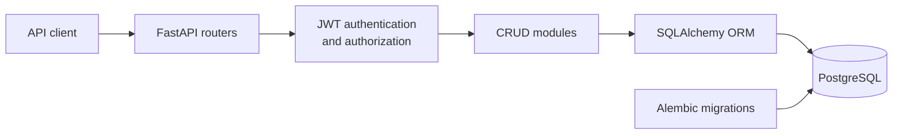
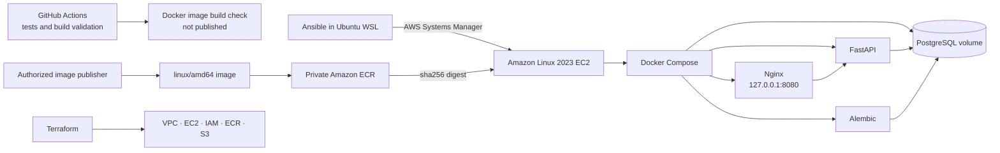

# Ticket-API

*Cloud-deployed REST API for ticket and incident management.*

**Python · FastAPI · PostgreSQL · Docker · AWS · Terraform · Ansible**

[](https://github.com/Orlando-Alvarez/Ticket-API/actions/workflows/ci.yml)

Ticket-API combines a versioned FastAPI backend with relational persistence,
JWT authentication, role and resource-level authorization, automated tests,
containerized execution, Infrastructure as Code, private image distribution,
and SSM-based AWS deployment automation.

The current AWS implementation deploys a digest-pinned image from private
Amazon ECR to EC2 and verifies database readiness through Nginx. The service is
intentionally bound to EC2 loopback while HTTPS, managed deployment secrets,
and safe public exposure remain future work.

## Contents

- [Current Status](#current-status)
- [Key Features](#key-features)
- [Technology Stack](#technology-stack)
- [Architecture](#architecture)
- [Quick Start](#quick-start)
- [API Overview](#api-overview)
- [AWS Deployment Overview](#aws-deployment-overview)
- [CI and Testing](#ci-and-testing)
- [Demo and Validation](#demo-and-validation)
- [Security Overview](#security-overview)
- [Roadmap](#roadmap)
- [Technical Documentation](#technical-documentation)

## Current Status

| Area | Status | Evidence |
| --- | --- | --- |
| FastAPI backend | Implemented | Users, authentication, tickets, incidents, health checks, RBAC, and soft delete |
| Local containers | Implemented | PostgreSQL, Alembic, FastAPI, and Nginx through Docker Compose |
| CI | Implemented | Ruff, application tests, PostgreSQL integration, and Docker image build |
| AWS infrastructure | Provisioned | VPC, subnets, routing, EC2, IAM/SSM, private ECR, and private S3 |
| EC2 configuration | Operator-verified | Docker Engine 25.0.14 and Docker Compose v2.39.4 installed idempotently |
| Image delivery | Operator-verified | `linux/amd64` image published to ECR and pulled by SHA-256 digest |
| EC2 application deployment | Operator-verified | PostgreSQL, migrations, FastAPI, and Nginx started; readiness returned HTTP 200 |
| Public AWS access | In development | Nginx is bound to `127.0.0.1:8080`; HTTPS is not configured |
| Continuous deployment | Planned | Jenkins or equivalent deployment automation is not implemented |
| Observability | Planned | Prometheus, Grafana, centralized logs, and alerts are not implemented |

## Key Features

### Backend

- Versioned REST endpoints under `/api/v1`
- OAuth2 password flow with HS256 JWT access tokens
- Argon2 password hashing
- `requester` and `admin` authorization policies
- Ticket access based on requester and assignee relationships
- Incident reporter scoping, pagination, and status/severity filters
- Atomic admin-only soft deletion with timestamp and actor auditing
- Pydantic validation and consistent JSON error envelopes
- Liveness and PostgreSQL readiness endpoints
- Swagger UI and ReDoc generated by FastAPI

### DevOps and Cloud

- Non-root Python 3.12 application image
- Health-aware Docker Compose startup and one-shot Alembic migrations
- Nginx reverse proxy with rate limiting and operational logs
- Terraform-managed AWS networking, compute, IAM, ECR, and S3
- AWS Systems Manager administration without public SSH
- Idempotent Ansible configuration and deployment
- Immutable ECR tags, scan on push, AES-256 encryption, and image retention
- Exact image selection by SHA-256 digest

## Technology Stack

| Responsibility | Technology |
| --- | --- |
| API and validation | Python 3.11+, FastAPI, Uvicorn, Pydantic |
| Persistence | PostgreSQL 16, SQLAlchemy 2, psycopg 3, Alembic |
| Authentication | PyJWT, OAuth2 password flow, pwdlib with Argon2 |
| Testing and linting | Pytest, FastAPI TestClient, httpx2, Ruff |
| Containers | Docker, Docker Compose, Nginx |
| AWS | EC2, VPC, IAM, ECR, Systems Manager, S3 |
| Automation | Terraform, Ansible, GitHub Actions |

## Architecture

### Backend



Route modules define HTTP contracts and authorization. Pydantic validates input,
CRUD modules handle persistence, SQLAlchemy maps the relational model, and
Alembic versions the schema. The project does not currently use a separate
service layer.

### AWS Deployment



GitHub Actions currently validates tests and an image build; it does not
publish to ECR or deploy to EC2. Image publication and Ansible deployment are
manual operator workflows.

See [Architecture](docs/architecture.md) for networks, data relationships,
startup dependencies, authorization flow, and detailed diagrams.

## Quick Start

### 1. Clone and Configure

```bash
git clone https://github.com/Orlando-Alvarez/Ticket-API.git
cd Ticket-API
```

Windows PowerShell:

```powershell
Copy-Item .env.example .env
```

macOS, Linux, or Ubuntu WSL:

```bash
cp .env.example .env
```

Replace the placeholder database password and `JWT_SECRET_KEY`. Never commit
`.env`.

### 2. Start the Local Stack

```bash
docker compose up -d --build
docker compose ps -a
```

### 3. Open the API

- Swagger UI: <http://127.0.0.1:8080/docs>
- ReDoc: <http://127.0.0.1:8080/redoc>
- Liveness: <http://127.0.0.1:8080/api/v1/health>
- Readiness: <http://127.0.0.1:8080/api/v1/health/ready>

### 4. Stop Without Deleting Data

```bash
docker compose down
```

The named PostgreSQL volume is preserved. See
[Local Development](docs/local-development.md) for direct Python execution,
migrations, logs, authentication examples, and safe data-management commands.

## API Overview

### Public Endpoints

| Method | Path | Purpose |
| --- | --- | --- |
| `GET` | `/api/v1/health` | Service liveness and version |
| `GET` | `/api/v1/health/ready` | PostgreSQL readiness through `SELECT 1` |
| `POST` | `/api/v1/users` | Register an active requester |
| `POST` | `/api/v1/auth/token` | Exchange credentials for a JWT |

### Protected Endpoints

| Method | Path | Access |
| --- | --- | --- |
| `GET` | `/api/v1/users/me` | Current active user |
| `GET` | `/api/v1/users/{user_id}` | Same user or admin |
| `GET` | `/api/v1/users` | Admin only |
| `PATCH` | `/api/v1/users/{user_id}` | Admin only |
| `POST` | `/api/v1/tickets` | Authenticated user subject to creation rules |
| `GET` | `/api/v1/tickets` | Related tickets; admins see all active tickets |
| `GET` | `/api/v1/tickets/{ticket_id}` | Requester, assignee, or admin |
| `PATCH` | `/api/v1/tickets/{ticket_id}` | Related user; relationship fields are admin-only |
| `DELETE` | `/api/v1/tickets/{ticket_id}` | Admin-only soft deletion |
| `POST` | `/api/v1/incidents` | Reporter is derived from the JWT |
| `GET` | `/api/v1/incidents` | Own incidents; admins see all active incidents |
| `GET` | `/api/v1/incidents/{incident_id}` | Reporter or admin |
| `PATCH` | `/api/v1/incidents/{incident_id}` | Reporter or admin; status is admin-only |
| `DELETE` | `/api/v1/incidents/{incident_id}` | Admin-only soft deletion |

Incident listing supports `status`, `severity`, `offset`, and `limit` with a
maximum page size of 100. Deleted tickets and incidents are excluded from
normal reads and cannot have deletion audit metadata overwritten.

## AWS Deployment Overview

The implemented manual workflow is:

1. Terraform provisions the AWS foundation and private ECR repository.
2. An authorized publisher builds the API image for `linux/amd64`.
3. The image is pushed under an immutable tag and resolved to a digest.
4. Ansible reaches EC2 through Systems Manager and pulls the exact digest.
5. Ansible copies the layered Compose/Nginx configuration and creates initial
   root-only deployment secrets.
6. Docker Compose starts PostgreSQL, migrations, FastAPI, and Nginx.
7. Ansible retries readiness until HTTP 200.

The AWS merge uses:

```text
docker-compose.yml + compose.prod.yaml + compose.aws.yaml
```

The final override removes PostgreSQL host exposure, uses the pre-pulled ECR
image for API and migrations, and binds Nginx to EC2 loopback.

See [AWS Infrastructure](docs/aws-infrastructure.md) and
[Deployment Runbook](docs/deployment.md) for the verified Windows PowerShell
commands, ECR publication, Terraform, Ansible, Compose layering, and secure SSM
port forwarding.

## CI and Testing

Run locally:

```bash
python -m ruff check .
python -m pytest -v
```

GitHub Actions defines three jobs:

1. Ruff and application tests on Python 3.12
2. PostgreSQL 16 integration tests after Alembic migrations
3. Docker image build after both test jobs succeed

The PostgreSQL migration tests require an isolated database named exactly
`ticket_api_test`. CI does not publish images or deploy to AWS.

See [Testing and Validation](docs/testing.md) for the test boundaries,
disposable integration database requirements, Compose checks, Ansible checks,
and manual infrastructure validation.

## Demo and Validation

Verified evidence currently includes:

- Swagger/OpenAPI generated from the implemented routes
- Liveness and readiness endpoints
- GitHub Actions workflow for tests and image-build validation
- Successful private ECR publication and EC2 pull
- Idempotent Docker/Compose configuration through Ansible
- Successful EC2 deployment and readiness HTTP 200
- Successful repeat deployment with `changed=1` from the one-shot migration
  container

No screenshots are committed yet. Useful future captures include a redacted
Swagger view, authenticated response, successful CI jobs, Ansible deployment
recap, and SSM-forwarded readiness response. Screenshots must exclude tokens,
credentials, AWS account IDs, instance IDs, registry hostnames, database URLs,
and Terraform state.

## Security Overview

Implemented controls include:

- Argon2 password hashing and expiring JWT access tokens
- Role, ownership, reporter, requester, and assignee authorization
- Atomic soft-delete auditing
- Non-root application container
- Docker network separation and no AWS PostgreSQL host port
- Nginx rate limiting and loopback-only AWS binding
- IMDSv2 and encrypted EC2 root storage
- No public SSH; administration through Systems Manager
- Private, encrypted ECR and S3 resources
- Pull-only ECR permissions for EC2
- Root-only EC2 deployment environment file

Important limitations:

- HTTP only; no public TLS ingress
- Host-local deployment secrets rather than Parameter Store or Secrets Manager
- Local Terraform state
- Partially manual controller IAM permissions
- No PostgreSQL backup/recovery automation
- No centralized monitoring, logging, or alerting

See [Security](docs/security.md) for the complete control and limitation model.

## Roadmap

1. Add HTTPS, certificate automation, and controlled public exposure.
2. Move deployment secrets to Parameter Store or Secrets Manager.
3. Implement PostgreSQL backup, restore, retention, and recovery procedures.
4. Move Terraform state to an encrypted remote backend with locking.
5. Automate ECR publication and digest promotion.
6. Add a reviewed Jenkins or equivalent continuous-deployment workflow.
7. Add Prometheus, Grafana, centralized logs, metrics, and alerts.
8. Parameterize inventory and ECR values and expand deployment/security tests.

## Technical Documentation

| Document | Contents |
| --- | --- |
| [Architecture](docs/architecture.md) | Backend layers, data model, containers, networks, AWS, and deployment flow |
| [Local Development](docs/local-development.md) | Environment setup, Docker Compose, direct Python execution, migrations, and auth examples |
| [AWS Infrastructure](docs/aws-infrastructure.md) | Terraform resources, IAM, ECR, AMI pinning, state, and verified PowerShell syntax |
| [Deployment Runbook](docs/deployment.md) | ECR publication, Ansible, EC2 deployment, idempotency, and SSM port forwarding |
| [Security](docs/security.md) | Application, container, AWS, IAM, secret, and network controls and limitations |
| [Testing and Validation](docs/testing.md) | Pytest, integration safety, CI, configuration checks, and operator validation |
| [Technical Decisions](docs/technical-decisions.md) | Engineering rationale and project-specific tradeoffs |
