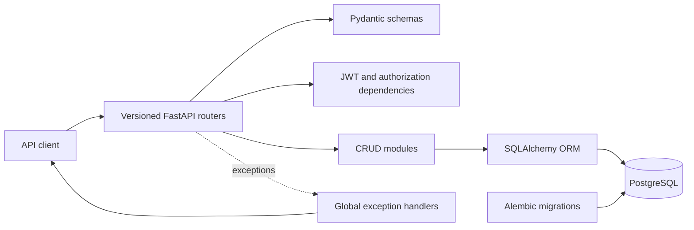
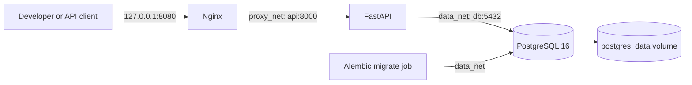
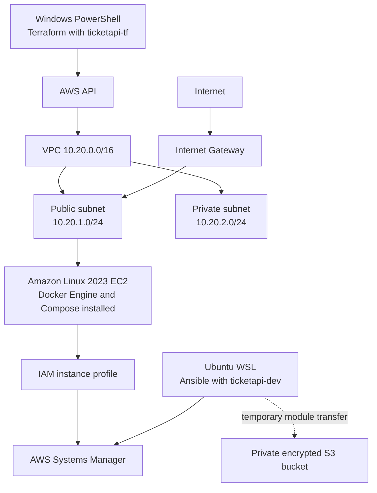
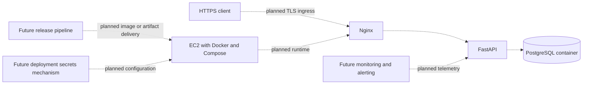

# Ticket-API

Ticket-API is a backend and infrastructure portfolio project for managing
support tickets and operational incidents. It combines a versioned FastAPI REST
API with PostgreSQL persistence, JWT authentication, role-based and
resource-level authorization, automated tests, containerized local execution,
and an AWS foundation provisioned with Terraform and configured through
Ansible.

The project is intended to demonstrate practical Backend Engineering and
DevOps/Cloud Engineering skills. It does not include a frontend.

## Implementation Status

| Area | Status | Current scope |
| --- | --- | --- |
| FastAPI backend | Implemented | Users, authentication, tickets, incidents, health endpoints, validation, RBAC, and soft deletion |
| Automated tests | Implemented | SQLite-backed API tests and isolated PostgreSQL schema/migration tests |
| Local containers | Implemented | FastAPI, PostgreSQL, Alembic migrations, and Nginx through Docker Compose |
| CI validation | Implemented | Ruff, unit tests, PostgreSQL integration tests, and Docker image build |
| AWS infrastructure | Provisioned | VPC, public/private subnets, routing, security group, EC2, IAM/SSM integration, and private S3 bucket |
| EC2 configuration | Implemented and operator-verified | Docker Engine 25.0.14 and Docker Compose v2.39.4 installed idempotently through Ansible over AWS Systems Manager |
| Application deployment to EC2 | In development | The container runtime is ready, but Ticket-API has not yet been started or health-checked on EC2 |
| Continuous deployment | Roadmap | Jenkins-based deployment automation has not been implemented |
| Production observability | Roadmap | Prometheus, Grafana, dashboards, alerts, and centralized observability have not been implemented |
| HTTPS | Roadmap | The current Nginx configuration serves HTTP only |

## Quick Start

The fastest supported path is the local Docker Compose environment.

1. Create a local environment file:

   ```powershell
   Copy-Item .env.example .env
   ```

   On macOS, Linux, or Ubuntu WSL, use `cp .env.example .env`.

2. Replace the placeholder database password and `JWT_SECRET_KEY` in `.env`.

3. Build and start PostgreSQL, migrations, FastAPI, and Nginx:

   ```bash
   docker compose up -d --build
   ```

4. Open Swagger UI at <http://127.0.0.1:8080/docs> or check readiness at
   <http://127.0.0.1:8080/api/v1/health/ready>.

Use `docker compose ps -a` to inspect the one-shot migration service and
`docker compose down` to remove containers while preserving database data.

## Verified Capabilities

- Versioned FastAPI endpoints for users, JWT authentication, tickets,
  incidents, liveness, and database readiness
- Pydantic validation, role and relationship-based authorization, PostgreSQL
  persistence, Alembic migrations, and atomic soft deletion
- A non-root API image, health-aware local Compose stack, Nginx reverse proxy,
  persistent database volume, and CI validation
- Terraform-managed AWS networking, EC2, IAM/SSM integration, and private S3
  transfer storage
- SSH-free, idempotent Docker Engine and Docker Compose configuration on Amazon
  Linux 2023 through Ansible

## Technology Stack

| Layer | Technology | Purpose |
| --- | --- | --- |
| Language | Python 3.11+ | Backend implementation; the container and CI use Python 3.12 |
| API | FastAPI and Uvicorn | REST endpoints, dependency injection, OpenAPI, and ASGI serving |
| Validation | Pydantic and pydantic-settings | Request/response schemas and environment-driven settings |
| Persistence | SQLAlchemy 2 and psycopg 3 | ORM mapping and PostgreSQL connectivity |
| Database | PostgreSQL 16 | Durable relational storage in the Compose environment |
| Migrations | Alembic | Versioned database schema changes |
| Security | PyJWT and pwdlib with Argon2 | JWT access tokens and password hashing |
| Testing | Pytest, FastAPI TestClient, and httpx2 | Unit, API, authorization, and integration tests |
| Static analysis | Ruff | Python linting in development and CI |
| Containers | Docker and Docker Compose | Reproducible application and database execution |
| Proxy | Nginx | Public HTTP entry point, throttling, forwarding, and logs |
| CI | GitHub Actions | Test, integration, and image-build validation |
| Infrastructure | Terraform and AWS Provider | Reproducible AWS resource provisioning |
| Configuration | Ansible and `amazon.aws` | EC2 configuration through Systems Manager |
| AWS | VPC, EC2, IAM, SSM, and S3 | Network, compute, access control, remote management, and temporary Ansible transfer storage |

## Architecture

### Backend application architecture



`app/api/routes` defines HTTP contracts and enforces the current authorization
rules. Pydantic schemas validate inputs and shape responses, while `app/crud`
contains database reads and writes through SQLAlchemy sessions. The repository
does not currently have a separate service layer; business authorization is
kept in the route modules and persistence logic in CRUD modules. Central
exception handlers normalize application, HTTP, validation, and unexpected
errors.

Most API tests replace the production database dependency with an in-memory
SQLite session. The dedicated integration tests use an isolated PostgreSQL
database to validate the real schema and Alembic migration behavior.

### Local Docker architecture

The base Compose file defines four services and two bridge networks:



- `nginx` is the only HTTP entry point and is connected only to `proxy_net`.
- `api` connects to both `proxy_net` and `data_net`; its port is not published
  directly to the host.
- `migrate` runs `python -m alembic upgrade head` and must finish successfully
  before the API starts.
- `db` is connected only to `data_net`. Development access from the host is
  bound to `127.0.0.1:5434`.
- PostgreSQL data persists in the named `postgres_data` volume.

The production-like override removes the host database port, keeps FastAPI
debug mode disabled, and publishes Nginx on host port 80. This override is a
container runtime configuration; it is not evidence of a completed AWS
deployment.

### Container build and request path

The Dockerfile starts from `python:3.12-slim`, disables bytecode generation,
enables unbuffered logs, and installs Ticket-API as a regular Python package.
Its BuildKit cache mount reuses downloaded Python packages between builds.
Alembic configuration and migration files are included in the runtime image so
the same image can serve both the `api` and `migrate` services.

The image creates a system user and group and runs Uvicorn as the non-root
`appuser` on port 8000. Nginx reaches that internal port through `proxy_net`.
Nginx forwards the original host, client IP, forwarding chain, and scheme;
applies five-second connection and 30-second read/write timeouts; emits request
and upstream timing logs to standard output; and returns `429` when its request
limit is exceeded. Liveness and readiness traffic is excluded from rate
limiting.

### AWS infrastructure architecture



The EC2 instance currently resides in the public subnet, receives a public IP,
and accepts inbound HTTP on port 80. Port 22 is not opened; administration uses
AWS Systems Manager. The private subnet and its route table exist but currently
host no project workload and have no NAT or Internet Gateway default route.

Docker Engine 25.0.14 and Docker Compose v2.39.4 have been installed on EC2
through separate Ansible playbooks. The Ticket-API application stack has not
yet been deployed or verified on that instance.

### Planned deployment architecture

The next milestone is to run the existing Compose stack on the configured EC2
host. The intended flow is shown separately because it is not implemented yet:



Image publishing, deployment secrets, application startup, HTTPS, and
monitoring remain design and implementation work. The diagram does not
represent a currently running AWS application deployment.

## Project Structure

```text
app/
  api/routes/               # Auth, health, users, tickets, and incidents
  core/                     # Settings, security, and exception handlers
  crud/                     # SQLAlchemy reads and writes
  db/                       # Engine, session dependency, and declarative base
  models/                   # User, Ticket, and Incident mappings
  schemas/                  # Pydantic request and response contracts
  main.py                   # FastAPI application factory

alembic/versions/           # Schema, Incident constraints, and soft-delete migrations
tests/                      # SQLite API tests and PostgreSQL integration tests

terraform/
  *.tf                      # Network, EC2, IAM, security, S3, and provider configuration
  terraform.tfvars.example  # Placeholder-only AMI variable template

ansible/
  Inventory/hosts.yml       # Static EC2 inventory using the SSM connection plugin
  playbooks/install_compose.yml
  playbooks/setup_docker.yml

.github/workflows/ci.yml
Dockerfile
docker-compose.yml
compose.prod.yaml
nginx/default.conf
alembic.ini
pyproject.toml
```

## API and Authorization

### Authentication model

- New public registrations are always stored as active `requester` users.
- Passwords are hashed with Argon2 and never returned by the API.
- `POST /api/v1/auth/token` accepts OAuth2 form data and returns a bearer token.
- JWTs use HS256, contain the user ID in `sub`, require an expiration claim, and
  expire after 30 minutes by default.
- Missing, invalid, or expired credentials return `401 Unauthorized`.
- Inactive users cannot log in or use protected endpoints.
- There is no public admin bootstrap endpoint. Initial admin promotion requires
  a trusted database or deployment process.
- Refresh tokens and token revocation are not currently implemented.

### Authorization summary

| Resource | Requester or related user | Admin |
| --- | --- | --- |
| Users | Read own profile | List, read, and update users |
| Tickets | Create for self; read/update requested or assigned tickets | Access all tickets, change relationships, and soft-delete |
| Incidents | Create for self; read/update own reported incidents except status | Access all incidents, change status, and soft-delete |

Incident ownership is derived from the authenticated user. The API does not
accept `reported_by_id` as an input or public list filter.

### Public endpoints

| Method | Path | Behavior |
| --- | --- | --- |
| `GET` | `/api/v1/health` | Liveness response with service name and version |
| `GET` | `/api/v1/health/ready` | Executes `SELECT 1`; returns `503` on a SQLAlchemy database error |
| `POST` | `/api/v1/users` | Registers an active requester |
| `POST` | `/api/v1/auth/token` | Exchanges email/password credentials for a JWT |

### Protected user endpoints

| Method | Path | Access |
| --- | --- | --- |
| `GET` | `/api/v1/users/me` | Current active user |
| `GET` | `/api/v1/users/{user_id}` | Same user or admin |
| `GET` | `/api/v1/users` | Admin only |
| `PATCH` | `/api/v1/users/{user_id}` | Admin only |

### Protected ticket endpoints

| Method | Path | Access |
| --- | --- | --- |
| `POST` | `/api/v1/tickets` | Authenticated user subject to creation rules |
| `GET` | `/api/v1/tickets` | Related tickets for non-admins; all active tickets for admins |
| `GET` | `/api/v1/tickets/{ticket_id}` | Requester, assignee, or admin |
| `PATCH` | `/api/v1/tickets/{ticket_id}` | Related user or admin; relationship fields are admin-only |
| `DELETE` | `/api/v1/tickets/{ticket_id}` | Admin-only soft deletion |

### Protected incident endpoints

| Method | Path | Access |
| --- | --- | --- |
| `POST` | `/api/v1/incidents` | Authenticated user; reporter comes from the JWT |
| `GET` | `/api/v1/incidents` | Own incidents for requesters; all active incidents for admins |
| `GET` | `/api/v1/incidents/{incident_id}` | Reporter or admin |
| `PATCH` | `/api/v1/incidents/{incident_id}` | Reporter or admin; status changes are admin-only |
| `DELETE` | `/api/v1/incidents/{incident_id}` | Admin-only soft deletion |

Incident listing supports:

```text
GET /api/v1/incidents?status=open&severity=high&offset=0&limit=50
```

Supported severities are `low`, `medium`, `high`, and `critical`. Supported
statuses are `open`, `investigating`, `resolved`, and `closed`. The maximum
page size is 100.

### Soft deletion

Ticket and Incident deletion uses a conditional SQL `UPDATE` that applies only
when `deleted_at` is still null. A successful deletion records a UTC timestamp
and the authenticated admin ID, returns `204 No Content`, and cannot have its
audit metadata overwritten by a repeated delete. Deleted rows are excluded
from list, detail, and update operations.

Restore, include-deleted, and hard-delete endpoints are not implemented.

### Validation and errors

Pydantic validates email addresses, password length, required fields, text
limits, Incident enums, pagination, explicit null values, and forbidden extra
fields. Incident constraints are also enforced in PostgreSQL.

Application errors use a consistent envelope:

```json
{
  "error": {
    "message": "Ticket not found."
  }
}
```

Validation errors add a `details` array. Unexpected exceptions return a generic
`500` response, and readiness failures do not expose SQL, credentials, or
connection details.

## Local Development

### Prerequisites

- Python 3.11 or later
- Docker Engine or Docker Desktop
- Docker Compose v2
- Git

### Environment configuration

Create `.env` from the placeholder-only `.env.example` as shown in Quick Start,
replace every placeholder locally, and never commit the resulting file.

| Variable | Required for | Description |
| --- | --- | --- |
| `DATABASE_URL` | Host API, Alembic, and PostgreSQL integration tests | SQLAlchemy PostgreSQL URL |
| `JWT_SECRET_KEY` | API and migration container startup | Secret used to sign and verify JWTs |
| `POSTGRES_USER` | Docker Compose | PostgreSQL user |
| `POSTGRES_PASSWORD` | Docker Compose | PostgreSQL password |
| `POSTGRES_DB` | Docker Compose | PostgreSQL database name |
| `APP_DEBUG` | Optional | FastAPI debug mode; defaults to `false` |
| `ACCESS_TOKEN_EXPIRE_MINUTES` | Optional | JWT lifetime; defaults to `30` |
| `APP_NAME`, `APP_VERSION`, `API_V1_PREFIX` | Optional | Service metadata and API prefix |

Compose constructs an internal `DATABASE_URL` with hostname `db`. When the API
or Alembic runs on the host against the Compose database, use
`localhost:5434`. A separately installed local PostgreSQL server may use its
own port, commonly `5432`.

Generate a development-only JWT secret locally:

```bash
python -c "import secrets; print(secrets.token_urlsafe(48))"
```

### Run with Docker Compose

Use the Quick Start command to build and launch the base stack. PostgreSQL must
become healthy, migrations must complete, and the API healthcheck must pass
before Nginx starts. ReDoc is available at <http://127.0.0.1:8080/redoc> and
liveness at <http://127.0.0.1:8080/api/v1/health>.

Inspect status and logs:

```bash
docker compose ps -a
docker compose logs migrate
docker compose logs -f api
docker compose logs -f nginx
```

Run the production-like override locally:

```bash
docker compose -f docker-compose.yml -f compose.prod.yaml up -d --build
```

This publishes Nginx on port 80 and does not publish PostgreSQL. It still uses
plain HTTP and is not a complete production deployment.

Stop services while preserving database data:

```bash
docker compose stop
```

Remove containers and Compose networks while preserving the named volume:

```bash
docker compose down
```

Do not use `docker compose down -v` unless permanent deletion of the local
database volume is intentional.

### Run directly with Python

Create and activate a virtual environment:

Windows PowerShell:

```powershell
python -m venv .venv
.\.venv\Scripts\Activate.ps1
```

macOS, Linux, or Ubuntu WSL:

```bash
python3 -m venv .venv
source .venv/bin/activate
```

Install the application and development dependencies:

```bash
python -m pip install --upgrade pip
python -m pip install -e ".[test]"
```

Apply migrations and start the API:

```bash
python -m alembic upgrade head
python -m uvicorn app.main:app --reload
```

Direct host execution serves Swagger at <http://127.0.0.1:8000/docs>.

## Testing and Static Analysis

Run Ruff:

```bash
python -m ruff check .
```

Run the complete Pytest collection:

```bash
python -m pytest -v
```

FastAPI tests use an in-memory SQLite database with dependency overrides. The
suite covers authentication, authorization, input validation, users, ticket
ownership and assignment, Incident scoping and filters, health behavior,
soft-delete visibility, and ORM metadata. No coverage percentage is currently
published.

The PostgreSQL integration tests inspect the migrated schema and perform a
soft-delete migration downgrade/upgrade round trip. They require an isolated
PostgreSQL database whose name is exactly `ticket_api_test`; otherwise they
skip or fail safely.

Example for an explicitly disposable database:

Windows PowerShell:

```powershell
$env:DATABASE_URL = "postgresql+psycopg://<test-user>:<test-password>@127.0.0.1:5432/ticket_api_test"
python -m alembic upgrade head
python -m pytest tests/integration -v
```

The GitHub Actions integration job provisions this database automatically.

## AWS Infrastructure with Terraform

Terraform code in `terraform/` targets AWS region `us-west-2`. It requires
Terraform `>= 1.17.0, < 2.0.0`, constrains the AWS provider to `~> 6.0`, and
currently locks provider version `6.73.0`.

### Provisioned resources

| Resource | Current configuration and purpose |
| --- | --- |
| VPC | `10.20.0.0/16` with DNS support and DNS hostnames enabled |
| Public subnet | `10.20.1.0/24` in `us-west-2a`, with public IP assignment |
| Private subnet | `10.20.2.0/24` in `us-west-2a`, without public IP assignment |
| Internet Gateway | Attached to the VPC for public internet connectivity |
| Public route table | Sends `0.0.0.0/0` through the Internet Gateway |
| Private route table | Associated with the private subnet; no public default route or NAT is configured |
| Security group | Allows inbound TCP/80 from IPv4 internet and all outbound IPv4 traffic; no SSH ingress |
| EC2 | Amazon Linux 2023, `t2.small` by default, public subnet, public IP, encrypted 16 GiB gp3 root volume |
| EC2 hardening | IMDSv2 tokens are required and the root volume is deleted on termination |
| IAM role and profile | Allows the EC2 instance to register with Systems Manager through `AmazonSSMManagedInstanceCore` |
| S3 bucket | Private bucket for temporary Ansible/SSM transfers, AES-256 server-side encryption, full public-access blocking, and one-day object expiration |

All named resources carry project, environment, and `ManagedBy = Terraform`
tags where supported.

### Pinned EC2 AMI

The EC2 resource uses `var.ec2_ami_id` directly. This intentionally pins the
Amazon Linux 2023 image so that a later public AMI update does not silently
produce a replacement plan for the instance.

An SSM public-parameter data source for the latest Amazon Linux 2023 AMI is
declared in `compute.tf`, but it is not connected to the EC2 `ami` argument.
The operator must select and provide a compatible AMI ID for `us-west-2`.

The repository includes a placeholder-only template. Copy it to the ignored
local variables file and replace the placeholder with a compatible AMI ID:

```powershell
Set-Location .\terraform
Copy-Item terraform.tfvars.example terraform.tfvars
```

Alternatively, provide the value without creating a file:

```powershell
$env:TF_VAR_ec2_ami_id = "ami-REPLACE_WITH_VALID_AMI"
```

Do not store account credentials or sensitive values in tracked variable
files. `.gitignore` excludes the populated `terraform.tfvars` file while
allowing `terraform.tfvars.example` to remain as a safe template.

### Terraform workflow from Windows PowerShell

Terraform uses the standard AWS credential chain. The provider does not embed a
profile or credentials, so select the restricted Terraform profile in the
shell:

```powershell
$env:AWS_PROFILE = "ticketapi-tf"
# Omit the next line when using a populated terraform.tfvars file.
$env:TF_VAR_ec2_ami_id = "ami-REPLACE_WITH_VALID_AMI"

aws sts get-caller-identity
Set-Location .\terraform

terraform init
terraform fmt -check
terraform validate
terraform plan -out=ticket-api.tfplan
terraform show ticket-api.tfplan
terraform apply ticket-api.tfplan
```

Review the saved plan before applying it. The workflow deliberately does not
use `terraform apply -auto-approve`.

The most recently recorded infrastructure verification was:

```text
terraform validate: successful
terraform plan: No changes. Your infrastructure matches the configuration.
```

These results refer to the last verified operator run. Always repeat
`terraform validate` and review a fresh `terraform plan` before applying
infrastructure changes.

### Terraform state and current limitations

- No remote backend is declared. State remains local unless the operator
  configures an external backend.
- `.gitignore` excludes `.terraform/`, state files, plans, crash logs, and
  non-example `.tfvars` files.
- State can contain sensitive infrastructure data and must never be committed.
- Some deployer and Ansible-controller IAM permissions were configured
  manually and are not fully represented by Terraform.
- Terraform currently defines no outputs for the EC2 instance ID, public IP, or
  Ansible S3 bucket. The static Ansible inventory must therefore be updated
  manually if those resources change.

## EC2 Configuration with Ansible

Ansible runs from Ubuntu WSL as the control node. It connects to the managed EC2
instance with `amazon.aws.aws_ssm`, not SSH. The security group therefore does
not need port 22.

### Control-node requirements

- Ubuntu WSL
- Python and Ansible
- AWS CLI configured with the `ticketapi-dev` profile
- AWS Session Manager Plugin
- `amazon.aws` Ansible collection
- Boto3, Botocore, and Botocore CRT support for AWS authentication and API
  operations
- Access to the project S3 bucket used for temporary module transfers

The current Ubuntu WSL controller runs Ansible in a `pipx`-managed environment.
Install AWS Python dependencies into that same isolated environment rather than
the system Python environment:

```bash
pipx install ansible
pipx runpip ansible install boto3 'botocore[crt]'
ansible-galaxy collection install amazon.aws
```

The existing environment specifically required the following command to add
CRT authentication support:

```bash
pipx runpip ansible install 'botocore[crt]'
```

As a reproducible alternative, keep Ansible and its dependencies together in a
dedicated virtual environment:

```bash
python3 -m venv ~/.venvs/ticket-api-ansible
source ~/.venvs/ticket-api-ansible/bin/activate
python -m pip install --upgrade pip
python -m pip install ansible boto3 'botocore[crt]'
ansible-galaxy collection install amazon.aws
```

Use one installation model consistently. Installing dependencies with the
system `pip` will not make them available to an Ansible executable isolated by
`pipx`.

Install AWS CLI and the Session Manager Plugin using the official AWS
instructions for the WSL distribution, then confirm the selected identity:

```bash
export AWS_PROFILE=ticketapi-dev
aws --version
session-manager-plugin
aws sts get-caller-identity
```

AWS profiles and credentials are environment-specific. A profile configured in
Windows is not automatically available inside WSL unless its AWS configuration
is explicitly shared or recreated there.

### Inventory

`ansible/Inventory/hosts.yml` contains a static host in group `ticket_api` and
defines:

- The managed EC2 instance ID as `ansible_host`
- `amazon.aws.aws_ssm` as the connection method
- Region `us-west-2`
- The private S3 transfer bucket
- AWS profile `ticketapi-dev`

The inventory contains resource identifiers but no passwords, access keys, or
SSH private keys.

### Validation and execution

Run these commands from the repository root inside Ubuntu WSL:

```bash
export AWS_PROFILE=ticketapi-dev

ansible-inventory -i ansible/Inventory/hosts.yml --graph

ansible -i ansible/Inventory/hosts.yml ticket_api \
  -m ansible.builtin.ping

ansible-playbook -i ansible/Inventory/hosts.yml \
  ansible/playbooks/setup_docker.yml --syntax-check

ansible-playbook -i ansible/Inventory/hosts.yml \
  ansible/playbooks/install_compose.yml --syntax-check

ansible-playbook \
  -i ansible/Inventory/hosts.yml \
  ansible/playbooks/setup_docker.yml

ansible-playbook \
  -i ansible/Inventory/hosts.yml \
  ansible/playbooks/install_compose.yml
```

`setup_docker.yml`:

1. Installs the `docker` package through Amazon Linux `dnf`.
2. Starts Docker and enables it at boot.
3. Runs `docker --version` without marking the verification as a change.
4. Displays the verified Docker Engine version, currently `25.0.14`.

Its recorded first and second runs completed with:

```text
first:  ok=5 changed=2 unreachable=0 failed=0
second: changed=0 failed=0
```

`install_compose.yml`:

1. Asserts that the EC2 architecture is `x86_64`.
2. Creates `/usr/local/lib/docker/cli-plugins` with root ownership.
3. Downloads the pinned Docker Compose `v2.39.4` binary for Linux x86-64.
4. Verifies the binary against the configured SHA-256 checksum before
   installation.
5. Runs `docker compose version` without reporting a configuration change.

Its recorded first and second runs completed with:

```text
first:  ok=6 changed=2 unreachable=0 failed=0
second: ok=6 changed=0 unreachable=0 failed=0
```

These successful results came from operator-run verification, not GitHub
Actions. Together they demonstrate idempotence: after the host reaches the
declared state, running the same automation again produces no unnecessary
changes. Idempotence makes configuration safer, repeatable, and suitable for
recovery or future delivery workflows.

The inventory graph and both playbook syntax checks have also been validated
successfully from Ubuntu WSL.

## Security and IAM

### Separate AWS profiles

| Profile | Used by | Responsibility |
| --- | --- | --- |
| `ticketapi-tf` | Terraform from Windows PowerShell | Assumes `TicketAPI-Terraform-Deployer` and provisions the AWS resources represented in Terraform |
| `ticketapi-dev` | Ansible from Ubuntu WSL | Starts authorized SSM sessions and accesses the dedicated Ansible transfer bucket |

Separating profiles prevents routine configuration management from inheriting
infrastructure-provisioning permissions. This follows least privilege: each
workflow receives only the permissions needed for its role.

The repository intentionally does not contain AWS access keys. The required IAM
permissions include the resource-specific EC2, VPC, IAM, S3, and SSM actions
needed by Terraform, plus SSM session and dedicated bucket access for Ansible.
Exact policies should remain scoped to this project and environment. Some of
these controller-side permissions are currently managed manually.

### Application and infrastructure security

- `.env` is ignored; `.env.example` contains placeholders only.
- `.dockerignore` excludes environment files, Git metadata, virtual
  environments, caches, and local build artifacts.
- Terraform state, plans, and real `.tfvars` files are ignored.
- JWT secrets and database passwords must be different for development and
  deployment environments.
- FastAPI runs as the non-root `appuser` in the container.
- Development ports bind to `127.0.0.1`; production-like Compose publishes only
  Nginx.
- Nginx limits API traffic to 10 requests per second per client with a burst of
  20; liveness and readiness checks are exempt.
- EC2 requires IMDSv2 and uses an encrypted gp3 root volume.
- EC2 exposes HTTP port 80 but not SSH port 22.
- The Ansible S3 bucket blocks all public access, encrypts objects with AES-256,
  and expires temporary objects after one day.
- HTTPS, managed application secrets, backup policy, centralized logs, metrics,
  and alerts are still required before treating the platform as production
  ready.

## Continuous Integration and Delivery

`.github/workflows/ci.yml` runs on pushes to `main` and `feat/**`, and on pull
requests targeting `main`.

It defines three jobs:

1. **Unit and static analysis**
   - Uses Python 3.12
   - Installs `.[test]`
   - Runs Ruff against `app` and `tests`
   - Runs Pytest while excluding `tests/integration`
2. **PostgreSQL integration**
   - Starts an isolated PostgreSQL 16 service database named
     `ticket_api_test`
   - Applies all Alembic migrations
   - Runs `tests/integration`
3. **Docker image build**
   - Runs only after both test jobs succeed
   - Builds `ticket-api:ci`

The current workflow validates code and container construction. It does not run
Terraform or Ansible, publish an image, deploy to EC2, or implement continuous
delivery. Jenkins is planned but not present in the repository.

## Roadmap

1. Deploy the existing Nginx/API/PostgreSQL Compose stack to EC2 with a secure
   environment configuration and verify its public health endpoints.
2. Add a container registry or equivalent release artifact flow and a reviewed
   Jenkins deployment pipeline.
3. Introduce HTTPS and a production domain and certificate strategy.
4. Add Prometheus metrics, Grafana dashboards, centralized logs, and alerts.
5. Move Terraform state to a protected remote backend with locking and bring
   remaining manual IAM configuration under reviewed infrastructure as code.
6. Add Terraform outputs and reduce static inventory maintenance.
7. Define production backup, restore, retention, and disaster-recovery
   procedures.
