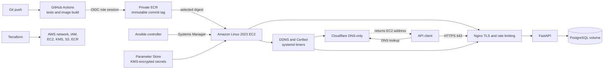
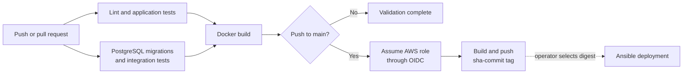

# Ticket-API

*Cloud-deployed REST API for ticket and incident management.*

**Python · FastAPI · PostgreSQL · Docker · AWS · Terraform · Ansible**

[](https://github.com/Orlando-Alvarez/Ticket-API/actions/workflows/ci.yml)
[](https://www.python.org/)
[](https://fastapi.tiangolo.com/)
[](https://docs.docker.com/compose/)

Ticket-API is a production-oriented backend portfolio project that combines a
versioned FastAPI service with relational persistence, JWT authentication,
role and resource-level authorization, automated tests, containerized
execution, Infrastructure as Code, private image delivery, and an AWS
deployment runbook. It demonstrates how application, security, and platform
concerns can be designed and documented as one maintainable system.

The current AWS implementation deploys a digest-pinned image from private
Amazon ECR to EC2, synchronizes application secrets from Systems Manager
Parameter Store, and serves the API through Nginx with Let's Encrypt TLS. A
Cloudflare DNS-only A record is synchronized with the instance's changing
public IPv4 address.

**Live API documentation:** [Swagger UI](https://api.orlandoalvarez.dev/docs) ·
[ReDoc](https://api.orlandoalvarez.dev/redoc)

## Current Status

| Area | Status | Evidence |
| --- | --- | --- |
| FastAPI backend | Implemented | Users, authentication, tickets, incidents, health checks, RBAC, and soft delete |
| Containers and CI | Implemented | Docker Compose, Alembic, Ruff, application tests, PostgreSQL integration, and Docker build validation |
| AWS platform | Applied and operator-verified | VPC, EC2, Systems Manager, KMS, Parameter Store, private ECR/S3, and Ansible deployment |
| GitHub OIDC IAM foundation | Applied and operator-verified | OIDC provider, dedicated publisher role, and repository-scoped ECR policy |
| Automatic ECR publication | Configured, not yet run-verified | Main-branch job is gated by CI and publishes `sha-<commit>` when successful |
| Public HTTPS automation | Implemented and operator-verified | Nginx, Let's Encrypt, Cloudflare DDNS, and Certbot renewal |
| Continuous deployment | Planned | Jenkins or equivalent deployment automation is not implemented |
| Observability | Planned | Prometheus, Grafana, centralized logs, and alerts are not implemented |

## Engineering Highlights

### Backend

- Versioned REST endpoints under `/api/v1`
- OAuth2 password flow, HS256 JWT access tokens, and Argon2 password hashing
- `requester` and `admin` policies with ticket relationship and incident reporter scoping
- Atomic admin-only soft deletion with timestamp and actor auditing
- Pydantic validation, consistent error envelopes, and generated OpenAPI documentation
- Liveness and PostgreSQL readiness checks

### DevOps and Cloud

- Non-root Python 3.12 application image
- Health-aware Docker Compose startup and one-shot Alembic migrations
- Nginx reverse proxy with TLS, rate limiting, and operational logs
- Terraform-managed AWS networking, compute, IAM, KMS, ECR, and S3
- Terraform-managed GitHub OIDC trust without long-lived AWS keys in GitHub
- Configured main-branch ECR publication gated by tests and image build
- AWS Systems Manager administration without public SSH
- KMS-encrypted Parameter Store secrets retrieved through the EC2 role
- Ansible deployment through Systems Manager with digest-pinned ECR images
- Cloudflare DDNS and automated Let's Encrypt DNS-01 renewal

## Technology Stack

| Responsibility | Technology |
| --- | --- |
| API and validation | Python 3.11+, FastAPI, Uvicorn, Pydantic |
| Persistence | PostgreSQL 16, SQLAlchemy 2, psycopg 3, Alembic |
| Authentication | PyJWT, OAuth2 password flow, pwdlib with Argon2 |
| Testing and linting | Pytest, FastAPI TestClient, Ruff |
| Containers | Docker, Docker Compose, Nginx |
| AWS | EC2, VPC, IAM, ECR, Systems Manager, KMS, Parameter Store, S3 |
| DNS and TLS | Cloudflare DNS, Let's Encrypt, Certbot, systemd |
| Automation | Terraform, Ansible, GitHub Actions |

## Architecture



FastAPI routes enforce authorization and delegate persistence to CRUD modules
and SQLAlchemy; Alembic owns schema evolution. Terraform provisions AWS,
GitHub Actions validates builds, ECR stores immutable images, and Ansible
deploys a selected digest to EC2 through Systems Manager. The OIDC/IAM
foundation is applied and operator-verified; GitHub role assumption and
automatic publication remain unverified. Cloudflare provides DNS only, so
HTTPS traffic connects directly to Nginx on EC2.

See [Architecture](docs/architecture.md) for networks, data relationships,
startup dependencies, authorization flow, and detailed diagrams.

## Quick Start

Prerequisites: Git, Docker Engine or Docker Desktop, and Docker Compose v2.24.4
or later. Python 3.11+ is needed only for direct host development.

### 1. Clone and Configure

```bash
git clone https://github.com/Orlando-Alvarez/Ticket-API.git
cd Ticket-API
```

```powershell
# Windows PowerShell
Copy-Item .env.example .env
```

```bash
# macOS, Linux, or Ubuntu WSL
cp .env.example .env
```

Set the placeholder PostgreSQL values and `JWT_SECRET_KEY`; never commit
`.env`. Compose constructs its internal database URL with hostname `db`.

### 2. Start the Local Stack

```bash
docker compose up -d --build
docker compose ps -a
```

The one-shot `migrate` service applies `alembic upgrade head` before FastAPI.

### 3. Open the API

- Swagger UI: <http://127.0.0.1:8080/docs>
- ReDoc: <http://127.0.0.1:8080/redoc>
- Liveness: <http://127.0.0.1:8080/api/v1/health>
- Readiness: <http://127.0.0.1:8080/api/v1/health/ready>

### 4. Stop

```bash
docker compose down
```

The PostgreSQL volume is preserved. See [Local Development](docs/local-development.md)
for environment variables, direct Python execution, migrations, logs, and
safe data-management commands.

## API Overview

### Public Endpoints

| Method | Path | Purpose |
| --- | --- | --- |
| `GET` | `/api/v1/health` | Service liveness and version |
| `GET` | `/api/v1/health/ready` | PostgreSQL readiness through `SELECT 1` |
| `POST` | `/api/v1/users` | Register an active requester |
| `POST` | `/api/v1/auth/token` | Exchange credentials for a JWT |

### Protected Endpoints

| Method | Path | Access |
| --- | --- | --- |
| `GET` | `/api/v1/users/me` | Current active user |
| `GET` | `/api/v1/users/{user_id}` | Same user or admin |
| `GET` | `/api/v1/users` | Admin only |
| `PATCH` | `/api/v1/users/{user_id}` | Admin only |
| `POST` | `/api/v1/tickets` | Authenticated user subject to creation rules |
| `GET` | `/api/v1/tickets` | Related tickets; admins see all active tickets |
| `GET` | `/api/v1/tickets/{ticket_id}` | Requester, assignee, or admin |
| `PATCH` | `/api/v1/tickets/{ticket_id}` | Related user; relationship fields are admin-only |
| `DELETE` | `/api/v1/tickets/{ticket_id}` | Admin-only soft deletion |
| `POST` | `/api/v1/incidents` | Reporter is derived from the JWT |
| `GET` | `/api/v1/incidents` | Own incidents; admins see all active incidents |
| `GET` | `/api/v1/incidents/{incident_id}` | Reporter or admin |
| `PATCH` | `/api/v1/incidents/{incident_id}` | Reporter or admin; status is admin-only |
| `DELETE` | `/api/v1/incidents/{incident_id}` | Admin-only soft deletion |

Incident listing supports `status`, `severity`, `offset`, and `limit` with a
maximum page size of 100. Deleted tickets and incidents are excluded from
normal reads and cannot have deletion audit metadata overwritten.

## CI/CD and Testing

Run static analysis and application tests locally:

```bash
python -m ruff check app tests ansible/files/cloudflare_ddns.py
python -m pytest --ignore=tests/integration -v
```

GitHub Actions defines four jobs:

1. Ruff and application tests on Python 3.12
2. PostgreSQL 16 integration tests after Alembic migrations
3. Docker image build after both test jobs succeed
4. ECR publication after the Docker build, only for pushes to `main`

The PostgreSQL job uses an isolated `ticket_api_test` database. The publication
job requests `id-token: write` only at job scope and pushes an immutable
commit-derived tag. It does not run Terraform, Ansible, or deploy to EC2.



The AWS OIDC provider, publisher role, and inline policy are applied and
operator-verified. GitHub role assumption and automatic ECR publication have
not yet been verified on `main`. Jenkins remains a planned CD orchestrator;
the current Ansible deployment is operator-controlled.

See [CI/CD and Image Delivery](docs/ci-cd.md) and
[Testing and Validation](docs/testing.md) for the complete job graph,
integration safety boundary, image identity, and validation procedures.

## Security Overview

Implemented controls include:

- Argon2 password hashing and expiring JWT access tokens
- Role, ownership, reporter, requester, and assignee authorization
- Atomic soft-delete auditing
- Non-root application image and separated Docker networks
- Nginx rate limiting, TLS 1.2/1.3, and no public HTTP, SSH, or PostgreSQL
- Main-branch-only GitHub OIDC trust with repository-scoped ECR publication
- Pull-only EC2 role and Systems Manager administration
- KMS-encrypted Parameter Store secrets and root-only host credentials

Important limitations:

- Single EC2 origin with no load balancer, Elastic IP, or high availability
- Cloudflare is DNS-only; it does not proxy or protect origin traffic
- Local Terraform state and partially manual controller IAM bootstrap
- No automatic credential rotation or PostgreSQL backup/recovery automation
- GitHub role assumption and automatic ECR publication are not run-verified
- No centralized monitoring, logging, or alerting

See [Security](docs/security.md) for the complete control and limitation model.

## Roadmap

1. Automate clean-host TLS bootstrap and controlled Cloudflare token rotation.
2. Implement coordinated PostgreSQL and JWT secret rotation and recovery.
3. Implement PostgreSQL backup, restore, retention, and recovery procedures.
4. Move Terraform state to an encrypted remote backend with locking.
5. Verify OIDC-based ECR publication and capture redacted workflow evidence.
6. Evaluate HSTS and a managed ingress strategy when availability requires it.
7. Add Prometheus, Grafana, centralized logs, metrics, and alerts.
8. Build once and promote the same verified artifact by digest before adding a
   reviewed deployment gate and rollback automation.
9. Parameterize inventory and ECR values and expand deployment/security tests.
10. Add an optional, low-cost Kubernetes learning environment after the
   security, CI/CD, reliability, and observability milestones.

## Technical Documentation

| Document | Contents |
| --- | --- |
| [Architecture](docs/architecture.md) | Backend layers, data model, containers, networks, AWS, and deployment flow |
| [Local Development](docs/local-development.md) | Environment setup, Docker Compose, direct Python execution, migrations, and auth examples |
| [AWS Infrastructure](docs/aws-infrastructure.md) | Terraform resources, IAM, ECR, AMI pinning, state, and verified PowerShell syntax |
| [Deployment Runbook](docs/deployment.md) | ECR publication, Ansible, EC2 deployment, idempotency, and SSM port forwarding |
| [Security](docs/security.md) | Application, container, AWS, IAM, secret, and network controls and limitations |
| [Testing and Validation](docs/testing.md) | Pytest, integration safety, CI, configuration checks, and operator validation |
| [CI/CD and Image Delivery](docs/ci-cd.md) | Workflow gates, GitHub OIDC, ECR publication, image identity, and deployment boundaries |
| [Technical Decisions](docs/technical-decisions.md) | Engineering rationale and project-specific tradeoffs |
| [HTTPS and Dynamic DNS](docs/https-ddns.md) | Cloudflare DDNS, Certbot DNS-01, systemd automation, token rotation, and troubleshooting |
