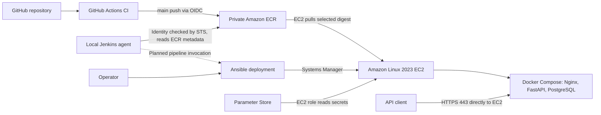

# Ticket-API

*Cloud-deployed REST API for ticket and incident management.*

**Python · FastAPI · PostgreSQL · Docker · AWS · Terraform · Ansible · GitHub Actions · Jenkins**

[](https://github.com/Orlando-Alvarez/Ticket-API/actions/workflows/ci.yml)
[](https://www.python.org/)
[](https://fastapi.tiangolo.com/)
[](https://docs.docker.com/compose/)

Ticket-API is a versioned FastAPI service for managing tickets and incidents.
It uses PostgreSQL, JWT authentication, and role- and resource-level access
controls. Docker Compose runs the application locally. Terraform provisions
AWS infrastructure, GitHub Actions tests and publishes the application image,
and Ansible deploys a selected image digest to EC2 through Systems Manager.

The current AWS implementation deploys a digest-pinned image from private
Amazon ECR to EC2, synchronizes application secrets from Systems Manager
Parameter Store, and serves the API through Nginx with Let's Encrypt TLS. A
Cloudflare DNS-only A record is synchronized with the instance's changing
public IPv4 address. A local Jenkins pipeline has validated AWS role assumption
and read-only ECR access as the first step toward automated deployment.

**Live API documentation:** [Swagger UI](https://api.orlandoalvarez.dev/docs) ·
[ReDoc](https://api.orlandoalvarez.dev/redoc)

## Current Status

| Area | Status | Evidence |
| --- | --- | --- |
| FastAPI backend | Implemented | Users, authentication, tickets, incidents, health checks, RBAC, and soft delete |
| Containers and CI | Implemented | Docker Compose, Alembic, Ruff, application tests, PostgreSQL integration, and Docker build validation |
| AWS platform | Applied and operator-verified | VPC, EC2, Systems Manager, KMS, Parameter Store, private ECR/S3, and Ansible deployment |
| GitHub OIDC IAM foundation | Applied and operator-verified | OIDC provider, dedicated publisher role, and repository-scoped ECR policy |
| Automatic ECR publication | Verified in GitHub Actions | A `main` run completed OIDC authentication and pushed an immutable `sha-<commit>` tag. [View the run](https://github.com/Orlando-Alvarez/Ticket-API/actions/runs/44975797065) |
| Jenkins AWS validation | Operator-reported local success | The tested script checked the STS role and retrieved an ECR digest. [Pipeline evidence](docs/ci-cd.md#pipeline-behavior-and-evidence) |
| Public HTTPS automation | Implemented and operator-verified | Nginx, Let's Encrypt, Cloudflare DDNS, and Certbot renewal |
| EC2 deployment | Operator-controlled | Ansible deploys a digest through SSM and checks database readiness |
| Jenkins-driven deployment | In development | Unattended authentication, deployment permissions, commit-based image selection, pipeline health checks, and recovery are pending |
| Observability | Planned | Prometheus, Grafana, centralized logs, and alerts are not implemented |

## Engineering Highlights

### Backend

- Versioned REST endpoints under `/api/v1`
- OAuth2 password flow, HS256 JWT access tokens, and Argon2 password hashing
- `requester` and `admin` policies with ticket relationship and incident reporter scoping
- Atomic admin-only soft deletion with timestamp and actor auditing
- Pydantic validation, consistent error envelopes, and generated OpenAPI documentation
- Liveness and PostgreSQL readiness checks

### DevOps and Cloud

- Non-root Python 3.12 application image
- Health-aware Docker Compose startup and one-shot Alembic migrations
- Nginx reverse proxy with TLS, rate limiting, and operational logs
- Terraform-managed AWS networking, compute, IAM, KMS, ECR, and S3
- Terraform-managed GitHub OIDC trust without long-lived AWS keys in GitHub
- Main-branch ECR publication gated by tests and image build
- Dedicated Jenkins agent with locally verified AWS identity and ECR digest lookups
- AWS Systems Manager administration without public SSH
- KMS-encrypted Parameter Store secrets retrieved through the EC2 role
- Ansible deployment through Systems Manager with digest-pinned ECR images
- Cloudflare DDNS and automated Let's Encrypt DNS-01 renewal

## Technology Stack

| Responsibility | Technology |
| --- | --- |
| API and validation | Python 3.11+, FastAPI, Uvicorn, Pydantic |
| Persistence | PostgreSQL 16, SQLAlchemy 2, psycopg 3, Alembic |
| Authentication | PyJWT, OAuth2 password flow, pwdlib with Argon2 |
| Testing and linting | Pytest, FastAPI TestClient, Ruff |
| Containers | Docker, Docker Compose, Nginx |
| Cloud infrastructure | EC2, VPC, IAM, ECR, Systems Manager, KMS, Parameter Store, S3 |
| DNS and TLS | Cloudflare DNS, Let's Encrypt, Certbot, systemd |
| Infrastructure as code | Terraform |
| Configuration and deployment | Ansible, AWS Systems Manager |
| CI/CD | GitHub Actions for CI and image publication, Jenkins for pre-deployment validation |

## Architecture



Terraform defines the VPC, subnets and routing, EC2, IAM, private ECR, the S3
bucket used for Ansible transfers, and the KMS key for Parameter Store secrets.
Cloudflare provides DNS for the EC2 origin. On the host, Nginx terminates TLS
and proxies requests to FastAPI. SQLAlchemy handles persistence and Alembic
manages the PostgreSQL schema.

See [Architecture](docs/architecture.md) for networks, data relationships,
startup dependencies, authorization flow, and detailed diagrams.

## Quick Start

Prerequisites: Git, Docker Engine or Docker Desktop, and Docker Compose v2.24.4
or later. Python 3.11+ is needed only for direct host development.

### 1. Clone and Configure

```bash
git clone https://github.com/Orlando-Alvarez/Ticket-API.git
cd Ticket-API
```

```powershell
# Windows PowerShell
Copy-Item .env.example .env
```

```bash
# macOS, Linux, or Ubuntu WSL
cp .env.example .env
```

Set the placeholder PostgreSQL values and `JWT_SECRET_KEY`; never commit
`.env`. Compose constructs its internal database URL with hostname `db`.

### 2. Start the Local Stack

```bash
docker compose up -d --build
docker compose ps -a
```

The one-shot `migrate` service applies `alembic upgrade head` before FastAPI.

### 3. Open the API

- Swagger UI: <http://127.0.0.1:8080/docs>
- ReDoc: <http://127.0.0.1:8080/redoc>
- Liveness: <http://127.0.0.1:8080/api/v1/health>
- Readiness: <http://127.0.0.1:8080/api/v1/health/ready>

### 4. Stop

```bash
docker compose down
```

The PostgreSQL volume is preserved. See [Local Development](docs/local-development.md)
for environment variables, direct Python execution, migrations, logs, and
safe data-management commands.

## API Overview

### Public Endpoints

| Method | Path | Purpose |
| --- | --- | --- |
| `GET` | `/api/v1/health` | Service liveness and version |
| `GET` | `/api/v1/health/ready` | PostgreSQL readiness through `SELECT 1` |
| `POST` | `/api/v1/users` | Register an active requester |
| `POST` | `/api/v1/auth/token` | Exchange credentials for a JWT |

### Protected Endpoints

| Method | Path | Access |
| --- | --- | --- |
| `GET` | `/api/v1/users/me` | Current active user |
| `GET` | `/api/v1/users/{user_id}` | Same user or admin |
| `GET` | `/api/v1/users` | Admin only |
| `PATCH` | `/api/v1/users/{user_id}` | Admin only |
| `POST` | `/api/v1/tickets` | Authenticated user subject to creation rules |
| `GET` | `/api/v1/tickets` | Related tickets; admins see all active tickets |
| `GET` | `/api/v1/tickets/{ticket_id}` | Requester, assignee, or admin |
| `PATCH` | `/api/v1/tickets/{ticket_id}` | Related user; relationship fields are admin-only |
| `DELETE` | `/api/v1/tickets/{ticket_id}` | Admin-only soft deletion |
| `POST` | `/api/v1/incidents` | Reporter is derived from the JWT |
| `GET` | `/api/v1/incidents` | Own incidents; admins see all active incidents |
| `GET` | `/api/v1/incidents/{incident_id}` | Reporter or admin |
| `PATCH` | `/api/v1/incidents/{incident_id}` | Reporter or admin; status is admin-only |
| `DELETE` | `/api/v1/incidents/{incident_id}` | Admin-only soft deletion |

Incident listing supports `status`, `severity`, `offset`, and `limit` with a
maximum page size of 100. Deleted tickets and incidents are excluded from
normal reads and cannot have deletion audit metadata overwritten.

## CI/CD and Testing

### GitHub Actions: CI and Image Publication

GitHub Actions validates changes on pushes to `main` and `feat/**` and pull
requests targeting `main`. It defines four jobs:

1. `test` runs Ruff and Pytest on Python 3.12, excluding `tests/integration`.
2. `postgres` starts PostgreSQL 16 with an isolated `ticket_api_test` database,
   applies `alembic upgrade head`, and runs `tests/integration`.
3. `docker` builds `ticket-api:ci` after both test jobs succeed.
4. `publish-ecr` runs after `docker` on pushes to `main`. It requests
   `id-token: write` at job scope, assumes the publisher role through GitHub
   OIDC, logs in to ECR, then rebuilds and pushes `sha-${GITHUB_SHA}` to the
   private `ticket-api` repository in `us-west-2`. ECR enforces immutable tags.

The [successful `main` run](https://github.com/Orlando-Alvarez/Ticket-API/actions/runs/44975797065)
includes successful OIDC, ECR login, and image push steps. The publication job
builds its own image. Promoting the exact artifact from the validation build
is future work.

Run static analysis and application tests locally:

```bash
python -m ruff check app tests ansible/files/cloudflare_ddns.py
python -m pytest --ignore=tests/integration -v
```

See [Testing and Validation](docs/testing.md) for isolated PostgreSQL testing
and configuration checks.

### Jenkins: Deployment Pipeline in Development

GitHub Actions owns source validation and image publication. Jenkins is the
separate deployment runner under development, with its own AWS identity and
the tooling needed for future Ansible and SSM stages. The local declarative
[pipeline](jenkinsfile) runs on `ticket-api-cd`, disables concurrent builds of
the job, and sets a 10-minute timeout. It sets `AWS_PROFILE=ticketapi-jenkins`,
`AWS_DEFAULT_REGION=us-west-2`, and `ECR_REPOSITORY=ticket-api`.

| Stage | Current behavior |
| --- | --- |
| `Verify AWS Identity` | Reads the STS caller ARN with `aws sts get-caller-identity` and fails unless it matches the expected account and assumed Jenkins role. |
| `Verify ECR images` | Calls `ecr describe-images`, selects the digest of the most recently pushed image by `imagePushedAt`, and rejects empty or `None` results. |

The operator's local run finished with `Finished: SUCCESS`, confirmed the
expected role, and returned a `sha256` digest. The ECR lookup is a smoke test.
Release selection by commit tag, digest format validation in Jenkins, and
EC2 deployment are future pipeline stages.

## Jenkins Setup and Local Testing

The development controller, `ticket-api-jenkins`, uses
`jenkins/jenkins:lts-jdk21` and is available at <http://localhost:18081> via a
loopback binding. The inbound agent, `ticket-api-cd-agent`, connects to the
controller over WebSocket on the shared `ticket-api-jenkins-net` Docker
network. The controller and the workspace use named Docker volumes mounted
at `/var/jenkins_home` and `/home/jenkins/agent`, respectively. Controller
startup, node registration, WebSocket connection, and AWS profile setup
are manual prerequisites for this development setup.

Build the agent image from the repository root. Its AWS CLI and Session
Manager Plugin installers target Linux x86-64.

```bash
docker build --platform linux/amd64 -t ticket-api-cd-agent:dev -f jenkins/agent/Dockerfile jenkins/agent
```

The [agent Dockerfile](jenkins/agent/Dockerfile) extends
`jenkins/inbound-agent:jdk21`. It includes Git, AWS CLI v2, the AWS Session
Manager Plugin, and a Python virtual environment with Ansible Core, Boto3,
and Botocore with CRT support. It installs `amazon.aws` and `community.docker`
and switches back to the `jenkins` user at runtime. A separate local validation
pipeline confirmed the development agent's tooling.

1. Register an inbound node with label `ticket-api-cd` and confirm it is
   online. Configure the `ticketapi-jenkins` profile for the agent's Jenkins
   user so it can assume the development role with temporary AWS credentials.
2. Validate the declarative syntax against the controller before running the
   pipeline. From Bash, set `JENKINS_USER` to your local Jenkins username and
   enter a Jenkins API token at the password prompt:

   ```bash
   curl --fail-with-body --user "$JENKINS_USER" \
     --form 'jenkinsfile=<jenkinsfile' \
     http://localhost:18081/pipeline-model-converter/validate
   ```

   Confirm the response says `Jenkinsfile successfully validated.`
   [Jenkins Declarative Pipeline linter](https://www.jenkins.io/doc/book/pipeline/development/#command-line-pipeline-linter)

3. To test pre-commit, create a Pipeline job, choose **Pipeline script**,
   paste the contents of `jenkinsfile`, and run the job. Review both stage
   results in the console output.
4. Once the file is available on GitHub, choose **Pipeline script from SCM**,
   select Git, point Jenkins at the repository and the branch containing the
   file, and set **Script Path** to `jenkinsfile`. The local filename is
   lowercase. Use the exact name checked into Git.
   [Jenkins Pipeline setup](https://www.jenkins.io/doc/book/pipeline/getting-started/)

## AWS IAM and Security

| Identity | Responsibility |
| --- | --- |
| Terraform deployer | Provisions AWS resources, including IAM roles and inline policies. Managing the Jenkins role requires separate permissions for the Terraform identity. |
| GitHub Actions publisher | Uses short-lived STS credentials through OIDC trust scoped to this repository's `main` ref. Publishing actions are scoped to the Ticket-API ECR repository. |
| Jenkins development role | Trusts a single development IAM principal for `sts:AssumeRole`. Its inline policy grants `ecr:DescribeImages` and `ecr:ListImages` on the Ticket-API repository. |
| Ansible operator | Uses the `ticketapi-dev` profile configured in the inventory to reach EC2 through SSM and use the S3 transfer bucket. |
| EC2 instance role | Provides SSM managed-instance access, pull-only ECR access, and scoped access to encrypted Parameter Store secrets. |

With the default variables, [Jenkins IAM configuration](terraform/iam_jenkins.tf)
defines `ticket-api-dev-jenkins-deployer` and references the existing
`TicketAPI-Jenkins-PermissionsBoundary` managed policy. The boundary caps
effective permissions. The inline policy grants the ECR metadata actions.
Provisioning the boundary policy itself and granting the Terraform identity
access to manage the Jenkins role are AWS-side prerequisites outside the
checked-in configuration. The GitHub publisher uses a separate IAM role.

The agent's `ticketapi-jenkins` profile currently relies on interactive
authentication with temporary AWS credentials. Expiration or a required
sign-in can interrupt unattended runs. Keep AWS profiles and credentials out
of images, pipeline definitions, and source control, and use a dedicated
short-lived workload identity before enabling unattended CD.

Other implemented controls include:

- Argon2 password hashing and expiring JWT access tokens
- Role, ownership, reporter, requester, and assignee authorization
- Atomic soft-delete auditing
- Non-root application image and separated Docker networks
- Nginx rate limiting, TLS 1.2/1.3, and no public HTTP, SSH, or PostgreSQL
- KMS-encrypted Parameter Store secrets and root-only host credentials

Important limitations:

- Single EC2 origin with no load balancer, Elastic IP, or high availability
- Cloudflare is DNS-only; it does not proxy or protect origin traffic
- Local Terraform state and partially manual controller IAM bootstrap
- No automatic credential rotation or PostgreSQL backup/recovery automation
- No centralized monitoring, logging, or alerting

See [Security](docs/security.md) for the complete control and limitation model.

## Deployment to EC2

An operator selects the release digest and runs the existing
[Ansible deployment playbook](ansible/playbooks/deploy_app.yml) through
Systems Manager. The playbook imports the ECR pull playbook, which validates
the `sha256:<digest>` value and pulls the image on EC2 when needed. Ansible
then copies Compose and Nginx configuration, synchronizes the protected
environment file from Parameter Store on EC2, validates the Compose merge,
and starts the stack. It retries the database readiness endpoint until it
returns HTTP 200 or the readiness check fails.

The AWS Compose stack publishes HTTPS on port 443. The readiness listener
maps EC2 host `127.0.0.1:8080` to Nginx container port 80. PostgreSQL has no
host port in this configuration. The operator workflow, prerequisites, and
exact commands are in the [Deployment Runbook](docs/deployment.md#deploy-ticket-api).

## Roadmap

1. Give Jenkins an unattended, short-lived AWS identity and scope the IAM
   permissions needed for Ansible, SSM, and S3 transfers.
2. Resolve the exact `sha-<commit>` tag to a digest and promote the same
   artifact across validation, publication, and deployment.
3. Add a Jenkins stage for Ansible deployment, with readiness and HTTPS
   smoke checks, release records, and tested recovery by a known-good digest.
4. Improve TLS bootstrap, credential rotation, PostgreSQL backup and restore,
   and Terraform state storage and locking.
5. Add centralized logs, metrics, and alerting before expanding the topology.

## Technical Documentation

| Document | Contents |
| --- | --- |
| [Architecture](docs/architecture.md) | Backend layers, data model, containers, networks, AWS, and deployment flow |
| [Local Development](docs/local-development.md) | Environment setup, Docker Compose, direct Python execution, migrations, and auth examples |
| [AWS Infrastructure](docs/aws-infrastructure.md) | Terraform resources, IAM, ECR, AMI pinning, state, and verified PowerShell syntax |
| [Deployment Runbook](docs/deployment.md) | ECR publication, Ansible, EC2 deployment, idempotency, and SSM port forwarding |
| [Security](docs/security.md) | Application, container, AWS, IAM, secret, and network controls and limitations |
| [Testing and Validation](docs/testing.md) | Pytest, integration safety, CI, configuration checks, and operator validation |
| [CI/CD and Image Delivery](docs/ci-cd.md) | Verified GitHub publication, local Jenkins validation, image identity, and troubleshooting |
| [Technical Decisions](docs/technical-decisions.md) | Engineering rationale and project-specific tradeoffs |
| [HTTPS and Dynamic DNS](docs/https-ddns.md) | Cloudflare DDNS, Certbot DNS-01, systemd automation, token rotation, and troubleshooting |
