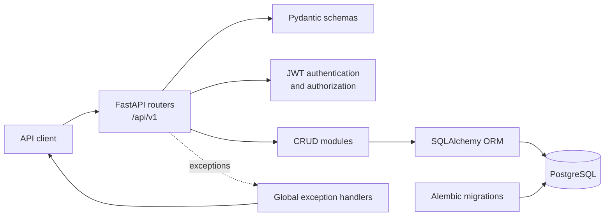
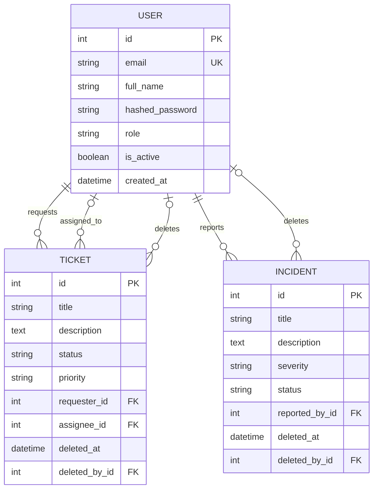
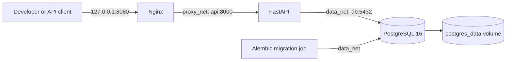
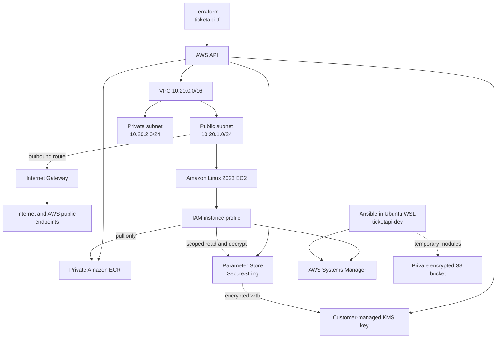
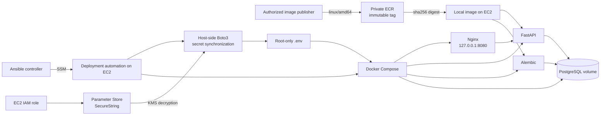

# Ticket-API Architecture

[Back to the main README](../README.md)

This document describes the implemented application, container, and AWS
architecture. Planned components are identified explicitly.

## System Boundaries

Ticket-API currently has three distinct operating contexts:

1. **Direct development:** Uvicorn and Alembic run on the host against
   PostgreSQL.
2. **Local containers:** Docker Compose builds the API image and runs
   PostgreSQL, migrations, FastAPI, and Nginx.
3. **AWS deployment:** Terraform provisions infrastructure, a prebuilt API
   image is distributed through private ECR, and Ansible deploys the Compose
   stack to EC2 through AWS Systems Manager.

The AWS deployment is operational but intentionally private: Nginx is bound to
`127.0.0.1:8080` on EC2. HTTPS and public application exposure are not
implemented.

## Backend Application Architecture



### Responsibilities

| Component | Location | Responsibility |
| --- | --- | --- |
| Application factory | `app/main.py` | Creates FastAPI, registers handlers, and mounts the versioned router |
| Router composition | `app/api/router.py` | Registers auth, health, user, ticket, and incident routers under `/api/v1` |
| Route modules | `app/api/routes/` | Define HTTP contracts and enforce current authorization rules |
| Schemas | `app/schemas/` | Validate request data and shape responses |
| CRUD modules | `app/crud/` | Execute SQLAlchemy reads and writes |
| ORM models | `app/models/` | Map users, tickets, and incidents to relational tables |
| Database session | `app/db/session.py` | Creates the engine and request-scoped SQLAlchemy sessions |
| Security | `app/core/security.py` | Hashes passwords, signs and decodes JWTs, and resolves the current user |
| Errors | `app/core/errors.py` | Normalizes application, HTTP, validation, and unexpected errors |
| Settings | `app/core/config.py` | Loads environment-backed application configuration |

The repository does not currently use a separate service layer. Business
authorization is enforced in route modules, while persistence operations live
in CRUD modules.

## Authentication and Authorization Flow

1. Public registration creates an active `requester`, regardless of privileged
   fields supplied by a client.
2. Passwords are hashed with Argon2.
3. `POST /api/v1/auth/token` validates OAuth2 form credentials.
4. Successful authentication returns an HS256 JWT containing `sub` and `exp`.
5. Protected routes resolve the active user from the token and database.
6. Route-specific policies enforce admin, ownership, reporter, requester, or
   assignee access.

There is no public admin bootstrap, refresh-token flow, or token revocation
mechanism.

## Data Model



Incident severity and status are constrained in both Pydantic and PostgreSQL.
Incident listing uses a reporter/creation/index ordering strategy and supports
status, severity, offset, and limit.

## Soft Deletion

Ticket and Incident deletion is admin-only. Each CRUD function uses a
conditional SQL `UPDATE` that succeeds only while `deleted_at` is null. The
operation records a UTC timestamp and the authenticated admin ID, preventing a
repeat request from overwriting audit metadata.

Deleted rows are excluded from list, detail, and update operations. Restore,
include-deleted, and hard-delete APIs are not implemented.

## Error Handling

Application errors use a consistent envelope:

```json
{
  "error": {
    "message": "Ticket not found."
  }
}
```

Validation errors add field details. Unexpected errors and database readiness
failures return generic messages without SQL, credentials, or connection
strings.

## Local Container Architecture



### Services

| Service | Role | Host exposure in the base configuration |
| --- | --- | --- |
| `db` | PostgreSQL 16 with persistent storage | `127.0.0.1:5434` |
| `migrate` | One-shot `alembic upgrade head` | None |
| `api` | Uvicorn/FastAPI | None |
| `nginx` | Reverse proxy and rate-limiting boundary | `127.0.0.1:8080` |

### Startup Dependencies

1. PostgreSQL passes `pg_isready`.
2. The migration service exits successfully.
3. FastAPI starts and passes its `/openapi.json` container healthcheck.
4. Nginx starts after the API becomes healthy.

`proxy_net` isolates Nginx-to-API traffic. `data_net` isolates API,
migration, and PostgreSQL traffic. The API joins both networks; PostgreSQL and
Nginx do not share a network.

## AWS Infrastructure Architecture



The EC2 instance has a public IP, but its security group has no ingress rules.
Public HTTP and SSH are both disabled. Unrestricted outbound IPv4 connectivity
supports the current AWS API, ECR, and package dependencies. The private subnet
exists without a NAT gateway and currently hosts no workload.

## AWS Image and Deployment Flow



The API and migration services use the same ECR image. The image is pulled
before Compose runs and is selected through
`TICKET_API_IMAGE=<repository>@sha256:<digest>`. Compose does not build or pull
the application image on EC2. Before Compose starts, the host-side script uses
the EC2 role to retrieve and decrypt the two managed parameters, validates any
existing `.env`, and reconstructs it only when absent. Containers read the
local file; they do not access Parameter Store directly.

## Planned Architecture Additions

The following components are not implemented:

- Public HTTPS ingress and certificate automation
- Automated PostgreSQL and JWT secret rotation
- Automated image publication and continuous deployment
- Centralized metrics, logs, dashboards, and alerts
- Remote Terraform state and locking
- PostgreSQL backup and disaster recovery
- Multi-host scheduling or high availability

