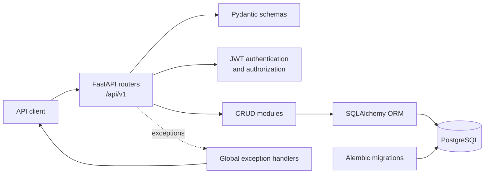
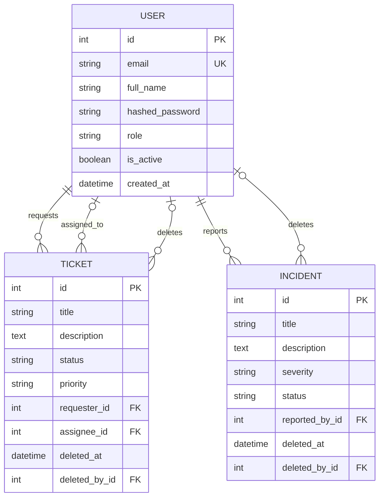
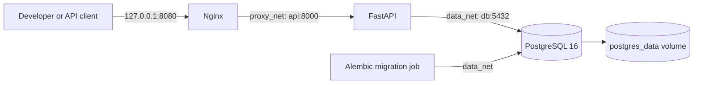
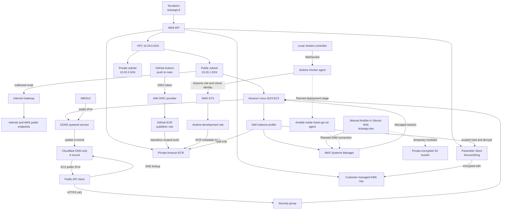

# Ticket-API Architecture

[Back to the main README](../README.md)

This document describes the implemented application, container, and AWS
architecture. Planned components are identified explicitly.

## System Boundaries

Ticket-API currently has four operating contexts:

1. **Direct development:** Uvicorn and Alembic run on the host against
   PostgreSQL.
2. **Local containers:** Docker Compose builds the API image and runs
   PostgreSQL, migrations, FastAPI, and Nginx.
3. **AWS delivery and deployment:** Terraform provisions infrastructure.
   GitHub Actions publishes commit-tagged images to private ECR after the
   quality gates on `main`. An operator runs Ansible from Ubuntu WSL to deploy
   a selected digest to EC2 over Systems Manager.
4. **Local Jenkins validation:** A Docker controller and inbound agent
   exercise AWS identity and ECR metadata access ahead of deployment automation.

The AWS deployment is publicly reachable at
`https://api.orlandoalvarez.dev`. Nginx publishes HTTPS on TCP 443 while its
HTTP listener remains bound to `127.0.0.1:8080` for readiness checks.
Cloudflare supplies DNS only; requests connect directly to EC2.

## Backend Application Architecture



### Responsibilities

| Component | Location | Responsibility |
| --- | --- | --- |
| Application factory | `app/main.py` | Creates FastAPI, registers handlers, and mounts the versioned router |
| Router composition | `app/api/router.py` | Registers auth, health, user, ticket, and incident routers under `/api/v1` |
| Route modules | `app/api/routes/` | Define HTTP contracts and enforce current authorization rules |
| Schemas | `app/schemas/` | Validate request data and shape responses |
| CRUD modules | `app/crud/` | Execute SQLAlchemy reads and writes |
| ORM models | `app/models/` | Map users, tickets, and incidents to relational tables |
| Database session | `app/db/session.py` | Creates the engine and request-scoped SQLAlchemy sessions |
| Security | `app/core/security.py` | Hashes passwords, signs and decodes JWTs, and resolves the current user |
| Errors | `app/core/errors.py` | Normalizes application, HTTP, validation, and unexpected errors |
| Settings | `app/core/config.py` | Loads environment-backed application configuration |

The repository does not currently use a separate service layer. Business
authorization is enforced in route modules, while persistence operations live
in CRUD modules.

### Request Lifecycle

1. Nginx forwards an API request to Uvicorn/FastAPI and preserves forwarding
   headers.
2. FastAPI matches the versioned route and resolves dependencies.
3. Pydantic validates path, query, form, or JSON input before route logic runs.
4. Protected routes decode the bearer JWT, load the current user through the
   request-scoped database session, and reject inactive or unknown users.
5. The route applies its admin, owner, reporter, requester, or assignee policy.
6. A CRUD function performs the SQLAlchemy query or mutation and commits only
   the intended transaction.
7. A response schema serializes the public fields. Password hashes and
   internal credentials are never response fields.
8. Application and framework exception handlers normalize errors into the
   documented JSON envelope without returning SQL or connection details.

OpenAPI, Swagger UI, and ReDoc are generated from the same route and schema
definitions. The endpoint summary in the main README is intentionally brief;
the deployed [Swagger UI](https://api.orlandoalvarez.dev/docs) is the detailed
interactive API reference.

## Authentication and Authorization Flow

1. Public registration creates an active `requester`, regardless of privileged
   fields supplied by a client.
2. Passwords are hashed with Argon2.
3. `POST /api/v1/auth/token` validates OAuth2 form credentials.
4. Successful authentication returns an HS256 JWT containing `sub` and `exp`.
5. Protected routes resolve the active user from the token and database.
6. Route-specific policies enforce admin, ownership, reporter, requester, or
   assignee access.

There is no public admin bootstrap, refresh-token flow, or token revocation
mechanism.

## Data Model



Incident severity and status are constrained in both Pydantic and PostgreSQL.
Incident listing uses a reporter/creation/index ordering strategy and supports
status, severity, offset, and limit.

Alembic owns the PostgreSQL schema history. The migration chain creates the
initial users, tickets, and incidents tables; adds Incident constraints and
indexes; and adds audited soft-delete fields and foreign keys. Application
startup does not call SQLAlchemy metadata creation in production; the one-shot
Compose migration service applies `alembic upgrade head` before FastAPI.

## Soft Deletion

Ticket and Incident deletion is admin-only. Each CRUD function uses a
conditional SQL `UPDATE` that succeeds only while `deleted_at` is null. The
operation records a UTC timestamp and the authenticated admin ID, preventing a
repeat request from overwriting audit metadata.

Deleted rows are excluded from list, detail, and update operations. Restore,
include-deleted, and hard-delete APIs are not implemented.

## Error Handling

Application errors use a consistent envelope:

```json
{
  "error": {
    "message": "Ticket not found."
  }
}
```

Validation errors add field details. Unexpected errors and database readiness
failures return generic messages without SQL, credentials, or connection
strings.

## Local Container Architecture



### Services

| Service | Role | Host exposure in the base configuration |
| --- | --- | --- |
| `db` | PostgreSQL 16 with persistent storage | `127.0.0.1:5434` |
| `migrate` | One-shot `alembic upgrade head` | None |
| `api` | Uvicorn/FastAPI | None |
| `nginx` | Reverse proxy and rate-limiting boundary | `127.0.0.1:8080` |

### Startup Dependencies

1. PostgreSQL passes `pg_isready`.
2. The migration service exits successfully.
3. FastAPI starts and passes its `/openapi.json` container healthcheck.
4. Nginx starts after the API becomes healthy.

`proxy_net` isolates Nginx-to-API traffic. `data_net` isolates API,
migration, and PostgreSQL traffic. The API joins both networks; PostgreSQL and
Nginx do not share a network.

## AWS Infrastructure Architecture



The EC2 instance has a public but non-elastic IPv4 address. Its security group
accepts public TCP 443 and has no public HTTP or SSH rule. Unrestricted outbound
IPv4 connectivity supports AWS APIs, ECR, package retrieval, Cloudflare, and
ACME operations. The private subnet exists without a NAT gateway and currently
hosts no workload. No Application Load Balancer or Elastic IP is provisioned.

## AWS Image and Deployment Flow

```mermaid
flowchart LR
    Change[Push to main] --> CI[GitHub Actions quality gates]
    CI --> OIDC[OIDC role assumption]
    OIDC -->|build and push<br/>sha-commit tag| ECR[Private ECR<br/>immutable tag]
    Jenkins[Jenkins Docker agent] -->|"Read image metadata"| ECR
    ECR -->|"Operator selects digest"| Operator[Operator]
    Operator --> ManualAnsible["Manual Ansible in Ubuntu WSL"]
    Jenkins -.->|"Planned deployment stage"| JenkinsAnsible["Ansible inside ticket-api-cd-agent"]
    ECR -->|"EC2 pulls selected digest"| Image[Local image on EC2]
    ManualAnsible --> SSM[AWS Systems Manager]
    JenkinsAnsible -.->|"Planned SSM connection"| SSM
    SSM --> Deploy[Deployment automation on EC2]
    Deploy --> Sync[Host-side Boto3<br/>secret synchronization]
    Role[EC2 IAM role] --> Parameters[Parameter Store<br/>SecureString]
    Parameters -->|KMS decryption| Sync
    Sync --> Env[Root-only .env]
    Parameters --> CloudTokens[DDNS and Certbot tokens]
    CloudTokens --> TLS[Host DDNS and Certbot automation]
    TLS --> Certs[Let's Encrypt certificates]
    Image --> API[FastAPI]
    Image --> Migrate[Alembic]
    Deploy --> Compose[Docker Compose]
    Env --> Compose
    Compose --> Nginx[Nginx<br/>HTTPS 443 and loopback HTTP]
    Certs -->|read-only mount| Nginx
    Compose --> API
    Compose --> Migrate
    Compose --> DB[(PostgreSQL volume)]
    Nginx --> API
    API --> DB
    Migrate --> DB
```



The workflow requests permission to mint an OIDC token only in the ECR
publication job. AWS accepts the role session only for this repository's
`main` branch, and the resulting policy can publish to the Ticket-API
repository. The job rebuilds the image and publishes `sha-${GITHUB_SHA}`
after both test jobs and the Docker build succeed. A successful
[`main` run](https://github.com/Orlando-Alvarez/Ticket-API/actions/runs/44975797065)
confirmed role assumption and image publication.

The operator's local Jenkins result confirmed AWS identity and ECR metadata
access for the tested script. The current manual deployment runs Ansible from
Ubuntu WSL. The dashed deployment path shows the planned Jenkins stage, with
Ansible running inside `ticket-api-cd-agent` and connecting to EC2 through AWS
Systems Manager. See [pipeline evidence](ci-cd.md#pipeline-behavior-and-evidence).

The API and migration services use the same ECR image. The image is pulled
before Compose runs and is selected through
`TICKET_API_IMAGE=<repository>@sha256:<digest>`. Compose does not build or pull
the application image on EC2. Before Compose starts, the host-side script uses
the EC2 role to retrieve and decrypt the two application parameters, validates any
existing `.env`, and reconstructs it only when absent. Containers read the
local file; they do not access Parameter Store directly. Separate host-side
automation retrieves the Cloudflare tokens, synchronizes DNS, renews the
certificate, and reloads Nginx only after configuration validation.

## Planned Architecture Additions

The following components are not implemented:

- Automated clean-host certificate bootstrap
- Automated PostgreSQL and JWT secret rotation
- Build-once artifact promotion, reviewed deployment, and automated rollback
- Centralized metrics, logs, dashboards, and alerts
- Remote Terraform state and locking
- PostgreSQL backup and disaster recovery
- Multi-host scheduling or high availability

The current public deployment is a single EC2 origin using a DNS-only record.
Cloudflare proxying, a load balancer, an Elastic IP, and managed certificate
termination are not part of the architecture.

