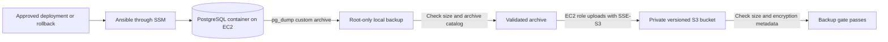

# PostgreSQL Backup and Restore

[Back to the main README](../README.md) · [Disaster Recovery](disaster-recovery.md)

## Backup Flow



[`backup_postgres.yml`](../ansible/playbooks/backup_postgres.yml) targets the
`ticket_api` inventory group and uses privilege escalation on EC2. It
requires PostgreSQL availability via `pg_isready`. It creates
`/var/backups/ticket-api` as root with mode `0700` and uses `umask 077` for
the dump. It names archives `ticket-api-<UTC timestamp>.dump`, where the
timestamp uses `YYYYMMDDTHHMMSSZ`. It runs `pg_dump -Fc --no-owner --no-acl`
inside `ticket-api-db` against the configured application database. This is a
logical database backup. PostgreSQL cluster roles and privileges need separate
reconstruction when applicable.

The playbook rejects an empty file and reads its archive catalog with
`pg_restore --list`. It records the local size, uploads under
`postgresql/automated/` with SSE-S3 (`AES256`), and checks
`HeadObject` for matching length and encryption metadata. These checks
confirm the archive catalog and object metadata. A full restore verifies
readability and database behavior. Equal lengths do not establish
cryptographic integrity of the archive.

Both Jenkins jobs invoke this playbook before applying the image. The backup
runs on EC2 and the upload uses the EC2 role. Authorized operators can invoke
it from the [Ansible control node](deployment.md#ansible-control-node).
Running it creates a backup file on EC2 and a new S3 object.

```bash
ansible-playbook -i ansible/Inventory/hosts.yml ansible/playbooks/backup_postgres.yml
```

## Storage and Retention

| Control | Implementation |
| --- | --- |
| Backup bucket | Separate from the temporary SSM transfer bucket, with public access blocked |
| Encryption | SSE-S3 with `AES256` by default and on playbook uploads |
| Versioning and lifecycle | Versioning enabled. Under `postgresql/`, current objects expire after 90 days and noncurrent versions after 30 days. Incomplete multipart uploads are aborted after 7 days |
| Deletion guard | Terraform `prevent_destroy` rejects plans to destroy the protected resource while the guard applies. S3 Object Lock is absent and external deletion remains possible subject to AWS permissions |
| Access | The EC2 role has `s3:PutObject`, `s3:GetObject`, and `s3:AbortMultipartUpload` under `postgresql/*`. Jenkins uses the separate SSM transfer bucket |
| Local disk | Backup files remain on EC2. The playbook has no local retention or cleanup step |

See [backup bucket Terraform](../terraform/s3_backups.tf) and
[backup IAM policy](../terraform/iam_backups.tf). Monitor disk headroom
before large dumps. With no scheduled job confirmed, backup age depends on
release activity and operator runs.

## Identify and Download

Use the successful job output to locate the backup created before the change.
Record its UTC timestamp, object key, and version ID if the incident process
requires distinguishing versions. A restore operator needs a separately
authorized AWS identity with read access to the chosen object. Treat both the
dump and downloaded copy as sensitive application data.

Run these Bash commands in a private working directory using an approved AWS
profile. Set `BACKUP_BUCKET` and `BACKUP_KEY` to the selected values locally.

```bash
umask 077
aws s3api head-object --bucket "$BACKUP_BUCKET" --key "$BACKUP_KEY" --region us-west-2
aws s3 cp "s3://$BACKUP_BUCKET/$BACKUP_KEY" ./ticket-api-backup.dump --region us-west-2
test -s ticket-api-backup.dump
```

For an older version, use the explicit object version with
`aws s3api get-object --version-id "$BACKUP_VERSION_ID"` along with the
bucket, key, region, and local output filename. Keep AWS metadata private.

## Isolated Restore Drill

Use a disposable PostgreSQL 16 container with no published ports, external
network, or production volume. Choose a fresh container name. The commands
use local trust authentication inside this isolated throwaway container.

```bash
docker run -d --name ticket-api-restore-drill --network none   -e POSTGRES_HOST_AUTH_METHOD=trust -e POSTGRES_DB=ticket_api_restore   postgres:16-alpine

# Wait until this reports that PostgreSQL accepts connections.
docker exec ticket-api-restore-drill pg_isready -U postgres -d ticket_api_restore

docker exec -i ticket-api-restore-drill pg_restore --list < ticket-api-backup.dump
docker exec -i ticket-api-restore-drill pg_restore --exit-on-error --no-owner --no-acl   -U postgres -d ticket_api_restore < ticket-api-backup.dump
docker exec ticket-api-restore-drill psql -v ON_ERROR_STOP=1 -U postgres   -d ticket_api_restore -c 'SELECT version_num FROM alembic_version;'
```

Confirm the restore exits successfully. Compare schema and representative
queries against the expected release using safe read-only queries. Verify
that relevant constraints and application invariants hold. Document the
restore result and elapsed time without publishing records. Clean up only
the confirmed disposable container and its anonymous volume when the
exercise finishes. Retain or dispose of the local dump under the
operator's approved data handling procedure.

The operator reported a successful isolated restore. Recurring drills,
local cleanup, additional integrity checks, and measured RPO and RTO are
future work. Follow [Disaster Recovery](disaster-recovery.md#database-recovery)
if production data recovery is needed.

## Troubleshooting

| Symptom | Check |
| --- | --- |
| PostgreSQL unavailable | Check `ticket-api-db`, Docker and host disk capacity. Keep the release blocked until a valid backup can be made |
| Empty or unreadable archive | Review the dump exit status, EC2 free space and PostgreSQL logs. Do not select it for recovery |
| Upload denied | Check the EC2 instance role and the permitted backup prefix |
| Metadata check fails | Confirm the selected key, expected size and SSE-S3 metadata before trusting the backup |
| Restore fails | Check PostgreSQL version, dump provenance, ownership and schema expectations in the isolated target |
