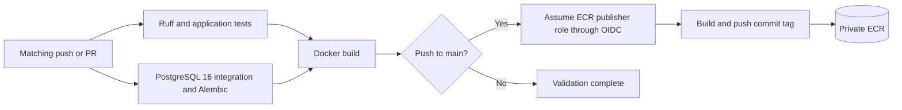

# Continuous Integration and Delivery

[Back to the main README](../README.md) · [Jenkins Operations](jenkins.md)

GitHub Actions performs continuous integration and publishes images. Jenkins
performs continuous delivery to EC2. The release can be validated and prepared
automatically, then an operator approves the runtime change. Continuous
deployment would apply eligible changes without that approval step.

## GitHub Actions Workflow

[`ci.yml`](../.github/workflows/ci.yml) runs for pushes to `main` and `feat/**`
and pull requests targeting `main`. `publish-ecr` requires a push event on
`refs/heads/main`, including a merge that updates the branch.

| Job | Inputs and checks |
| --- | --- |
| `test` | Python 3.12, test extra, Ruff on `app`, `tests` and the DDNS script, followed by Pytest excluding `tests/integration` |
| `postgres` | PostgreSQL 16 service with disposable `ticket_api_test`, `alembic upgrade head`, and the PostgreSQL integration tests |
| `docker` | Waits for both test jobs and builds `ticket-api:ci` |
| `publish-ecr` | Waits for the Docker job. Gets a short-lived AWS session, logs in to ECR, rebuilds the image, and pushes `sha-${GITHUB_SHA}` |

The Docker build job verifies that the image builds. Publication creates a
separate build. Promoting the exact tested image or a signed release bundle
remains future work. The
[successful main run](https://github.com/Orlando-Alvarez/Ticket-API/actions/runs/44975797065)
shows both test jobs, Docker build, role assumption, ECR login, and image
publication succeeding.

## Image Identity and Trust Boundaries

| Identifier | Meaning |
| --- | --- |
| Git commit SHA | Identifies a source revision. Both Jenkins jobs expect full 40-character lowercase hexadecimal SHAs |
| Docker image tag | Registry name `sha-<commit>` assigned by the workflow. ECR enforces immutability |
| Registry image digest | Content identifier of an image manifest or index. Deployment pins `<repository>@sha256:<digest>` |
| Local Docker image ID | Docker daemon's identifier for the local image, typically the image config digest. Compare the container's configured repository digest when verifying a deployment |

GitHub Actions defaults to `contents: read`. The publication job alone adds
`id-token: write`. AWS trust requires the GitHub OIDC provider, the
`sts.amazonaws.com` audience, and the exact repository subject for `main`.
The publisher can authenticate to ECR, with upload operations limited to
`ticket-api`. Jenkins uses a separate STS role based on the temporary
`ticketapi-jenkins` profile. The EC2 runtime pulls images with its instance
role. See [Security](security.md#aws-identity-separation).

The [ECR lifecycle rule](../terraform/ecr.tf) expires untagged images 90 days
after push. This rule does not count or expire tagged releases. Always check
that a rollback candidate is still available.

## Jenkins Release Handoff

[`Jenkinsfile`](../Jenkinsfile) resolves `RELEASE_SHA` to the immutable commit
tag and validates its digest and ancestry in `origin/main`. After local tooling
and syntax checks, an operator approves the release. Jenkins verifies SSM and
EC2 prerequisites, records the previous pinned image, checks its availability
in ECR, runs the PostgreSQL backup, then deploys and verifies the new digest
through Ansible. Jenkins consumes ECR images without a Docker build.

[`Jenkinsfile.rollback`](../Jenkinsfile.rollback) resolves both `CURRENT_SHA`
and `ROLLBACK_SHA`. The job checks ancestry, selected file differences,
and the currently deployed digest. After approval and backup it checks the
current digest again, applies the target digest and verifies it. The
[rollback runbook](jenkins.md#controlled-rollback) describes the safety gate
and the shell issue observed in the current source.

Both jobs use `disableConcurrentBuilds()` and share the
`ticket-api-ec2-deployment` lock. The lock coordinates builds on the same
controller. Authorized WSL operations must be coordinated separately.

The deployment failure handler skips diagnostics before the modifying phase.
After that phase begins, it attempts to inspect EC2 and archive the result
for an operator decision. See [Disaster Recovery](disaster-recovery.md) and
[Backup and Restore](backup-and-restore.md).

Ansible copies runtime configuration from the Jenkins SCM checkout.
The selected image's commit can differ from that checkout. The rollback Git
diff covers specific paths and does not prove deployment configuration or
database compatibility. See [Deployment](deployment.md) for the manual path.

## Troubleshooting Publication

| Symptom | Check |
| --- | --- |
| Publication skipped | Verify a push event to `main` and successful upstream jobs |
| OIDC denied | Check the event and ref, job permission, exact trust subject and AWS audience |
| ECR push denied | Check the publisher role, region, and repository permissions |
| Immutable tag exists | Inspect the existing tag and digest for the same commit before retrying |
| Build and publication images differ | Review the separate builds and the publication digest |
| Jenkins cannot resolve a release | Verify the full SHA is in `main` and its exact tag still exists in ECR |

See [Testing](testing.md#operator-verified-delivery-evidence) for reported
deployments, rollback, lock tests, failure simulations, and restore evidence.

