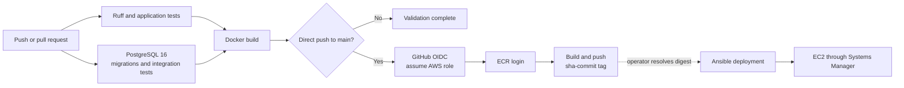

# CI/CD and Image Delivery

[Back to the main README](../README.md)

This document describes the GitHub Actions workflow, its AWS federation
boundary, and the handoff from image publication to operator-controlled
deployment. It distinguishes configuration present in the repository from
behavior verified in a live workflow run.

## Current Status

| Capability | Status | Evidence boundary |
| --- | --- | --- |
| Ruff and application tests | Implemented | Defined in `.github/workflows/ci.yml` |
| PostgreSQL migration and integration tests | Implemented | PostgreSQL 16 service and isolated `ticket_api_test` database |
| Docker image build | Implemented | Gated on both test jobs |
| AWS OIDC and publisher IAM foundation | Applied and operator-verified | Terraform created the provider, dedicated role, and inline ECR policy |
| GitHub Actions role assumption | Configured, not yet run-verified | No successful main-branch workflow evidence yet |
| ECR image publication | Configured, not yet verified | Conditional main-branch job and repository-scoped push policy are present |
| EC2 deployment | Operator-controlled | Ansible deploys a selected digest through Systems Manager |
| Continuous deployment | Not implemented | No workflow job changes the EC2 runtime |

The applied IAM resources verify the AWS trust and permission foundation. The
previously verified manual ECR publication proves that the repository and
manual publisher path worked. Neither result proves that the GitHub Actions job
can assume its role or publish an image automatically.

## Workflow Triggers

The workflow runs for:

- Pushes to `main`
- Pushes to `feat/**`
- Pull requests targeting `main`

Image publication has an additional job-level condition. It runs only for a
`push` event whose ref is exactly `refs/heads/main`. Pull requests and feature
branches can validate the application and image build but cannot reach the
publication job.

## Job Graph



### Application Test Job

- Runs on Ubuntu with Python 3.12.
- Installs the project with the `test` dependency group.
- Runs Ruff against `app`, `tests`, and the Cloudflare DDNS script.
- Runs Pytest with `tests/integration` excluded.
- Uses test-only placeholder configuration and does not connect to a real
  development or production database.

### PostgreSQL Integration Job

- Starts `postgres:16-alpine` as a service.
- Uses the isolated database name `ticket_api_test` required by the migration
  safety guard.
- Applies `alembic upgrade head` before the integration suite.
- Validates PostgreSQL-specific constraints, migrations, and atomic repeated
  soft-deletion behavior.

### Docker Build Job

- Depends on both test jobs.
- Builds `ticket-api:ci` from the repository Dockerfile.
- Does not push the image or pass it as an artifact to another job.

### ECR Publication Job

- Depends on the Docker build job.
- Runs only for direct pushes to `main`.
- Checks out the exact workflow revision.
- Exchanges a GitHub OIDC token for short-lived AWS credentials.
- Logs in to the private ECR registry.
- Rebuilds and pushes `sha-${GITHUB_SHA}`.

The publication job currently builds the image a second time. Therefore, the
Docker build job validates that the source can build, while the publication
job creates the registry artifact independently. A stronger future design
would build once, identify the resulting digest, and promote that exact
verified artifact.

## Permissions and Trust Boundaries

The workflow defaults to `contents: read`. Only the publication job adds
`id-token: write`, which is required for GitHub to issue the OIDC token used by
AWS STS.

Terraform defines:

1. An IAM OIDC provider for `https://token.actions.githubusercontent.com` with
   the `sts.amazonaws.com` audience.
2. A dedicated publisher role whose trust policy requires the exact subject
   `repo:Orlando-Alvarez/Ticket-API:ref:refs/heads/main`.
3. An inline policy allowing ECR authentication and limiting repository
   operations used for publication to the Ticket-API repository ARN.

The role is not the EC2 instance role. EC2 remains pull-only. It is also not
the Terraform controller or Ansible operator identity. This separation keeps
image publication, runtime access, configuration management, and
infrastructure provisioning in distinct permission domains.

No long-lived AWS access key is required in GitHub. The role ARN used by the
workflow is an infrastructure identifier rather than a secret, but its current
hard-coded value is environment-specific and should eventually be configured
without duplicating account-specific values in workflow source.

## Image Identity and Deployment Handoff

ECR tags are immutable. The workflow's tag format is:

```text
sha-<full 40-character Git commit SHA>
```

Before deployment, an operator resolves that tag to the ECR image digest and
records both values:

```bash
IMAGE_TAG="sha-<full-commit-sha>"

aws ecr describe-images \
  --repository-name ticket-api \
  --image-ids "imageTag=${IMAGE_TAG}" \
  --query 'imageDetails[0].imageDigest' \
  --output text \
  --region us-west-2
```

Ansible then deploys `<repository>@sha256:<digest>`. The workflow does not edit
the EC2 environment, invoke Ansible, or restart the application. This manual
handoff is an intentional release boundary until reviewed deployment approval,
health verification, and rollback are automated.

Jenkins is a planned candidate for future CD orchestration, subject to the
final architecture decision. No Jenkins controller, pipeline, credential, or
deployment integration is implemented in this repository.

## Verification Checklist

After the workflow changes reach `main`, verify the publication path without
exposing account data or credentials:

1. Confirm the test, PostgreSQL, and Docker jobs succeed.
2. Confirm the ECR publication job is selected only for the `main` push.
3. Confirm AWS credential configuration reports successful role assumption.
4. Confirm ECR contains exactly one immutable `sha-<commit>` tag for that run.
5. Resolve the tag to a `sha256:` digest and compare it with the registry
   result.
6. Confirm no AWS access-key secrets were added to the repository or GitHub.
7. Capture redacted evidence that omits account IDs, registry hostnames, role
   ARNs, session identifiers, tokens, and environment values.

Do not describe GitHub Actions role assumption or automatic publication as
verified until these checks complete on `main`. The underlying OIDC provider,
role, and inline policy are already applied and operator-verified.

## Troubleshooting

### Publication Job Is Skipped

Confirm that the event is a direct push to `main`. A pull request, feature
branch, rerun with a different ref, or failure in an upstream job correctly
prevents publication.

### OIDC Role Assumption Fails

Compare the token audience, repository owner/name, branch ref, IAM provider,
and workflow `id-token` permission with the Terraform trust policy. Do not
weaken the subject to a wildcard merely to make federation succeed.

### ECR Push Is Denied

Confirm that the configured repository name matches the Terraform-managed ECR
repository and that the publisher policy is attached to the assumed role. Do
not add broad ECR permissions when one repository ARN is sufficient.

### Immutable Tag Already Exists

The full commit-derived tag should identify one source revision. If it already
exists, inspect whether the workflow is replaying a published commit. Do not
make tags mutable; select the existing digest or define a deliberate retry
policy that preserves artifact identity.

### Published Image Differs from the Validation Build

The current jobs build independently. Treat this as a known provenance gap,
not as proof of tampering. The planned remediation is to build once and carry
the same digest through validation, publication, and deployment.

## Planned Improvements

- Verify the OIDC publication path on `main` and retain redacted evidence.
- Build once and promote the same verified artifact.
- Add software bill of materials and provenance generation.
- Evaluate image signing and vulnerability-policy gates.
- Make environment-specific role and registry values configurable.
- Add an explicit, reviewed deployment approval with readiness verification.
- Implement release records and tested rollback by known-good digest.

