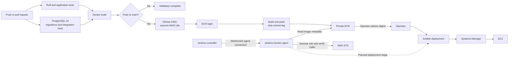

# CI/CD and Image Delivery

[Back to the main README](../README.md)

This document describes the GitHub Actions workflow, its AWS federation
boundary, the local Jenkins validation pipeline, and the operator-controlled
handoff from ECR to EC2.

## Current Status

| Capability | Status | Evidence boundary |
| --- | --- | --- |
| Ruff and application tests | Implemented | Defined in `.github/workflows/ci.yml` |
| PostgreSQL migration and integration tests | Implemented | PostgreSQL 16 service and isolated `ticket_api_test` database |
| Docker image build | Implemented | Gated on both test jobs |
| AWS OIDC and publisher IAM foundation | Applied and operator-verified | Terraform created the provider, dedicated role, and inline ECR policy |
| GitHub Actions role assumption and ECR publication | Verified in GitHub Actions | The [main run](https://github.com/Orlando-Alvarez/Ticket-API/actions/runs/44975797065) completed OIDC authentication, ECR login, and image push |
| Jenkins toolchain and AWS validation | Operator-reported local success | The agent tooling was checked, and a local job verified the STS identity and retrieved an ECR digest. See [pipeline behavior and evidence](#pipeline-behavior-and-evidence). |
| EC2 deployment | Manual | Ansible deploys a selected digest through Systems Manager |
| Jenkins-driven continuous deployment | In development | Workload identity, deployment permissions, commit-to-digest selection, and deployment stages are pending |

The GitHub run also completed the application, PostgreSQL, and Docker build
jobs. Image publication and EC2 deployment have separate execution paths.

## Workflow Triggers

The workflow runs for:

- Pushes to `main`
- Pushes to `feat/**`
- Pull requests targeting `main`

Image publication has an additional job-level condition. It runs only for a
`push` event whose ref is exactly `refs/heads/main`. Pull requests and feature
branches can validate the application and image build but cannot reach the
publication job.

## Job Graph



### Application Test Job

- Runs on Ubuntu with Python 3.12.
- Installs the project with the `test` dependency group.
- Runs Ruff against `app`, `tests`, and the Cloudflare DDNS script.
- Runs Pytest with `tests/integration` excluded.
- Uses test-only placeholder configuration and does not connect to a real
  development or production database.

### PostgreSQL Integration Job

- Starts `postgres:16-alpine` as a service.
- Uses the isolated database name `ticket_api_test` required by the migration
  safety guard.
- Applies `alembic upgrade head` before the integration suite.
- Validates PostgreSQL-specific constraints, migrations, and atomic repeated
  soft-deletion behavior.

### Docker Build Job

- Depends on both test jobs.
- Builds `ticket-api:ci` from the repository Dockerfile.
- Does not push the image or pass it as an artifact to another job.

### ECR Publication Job

- Depends on the Docker build job.
- Runs only for `push` events on `main`, including merge commits.
- Checks out the exact workflow revision.
- Exchanges a GitHub OIDC token for short-lived AWS credentials.
- Logs in to the private ECR registry.
- Rebuilds and pushes `sha-${GITHUB_SHA}` to `ticket-api` in `us-west-2`.

The publication job currently builds the image a second time. Therefore, the
Docker build job validates that the source can build, while the publication
job creates the registry artifact independently. A stronger future design
would build once, identify the resulting digest, and promote that exact
verified artifact.

## Permissions and Trust Boundaries

The workflow defaults to `contents: read`. Only the publication job adds
`id-token: write`, which is required for GitHub to issue the OIDC token used by
AWS STS.

Terraform defines:

1. An IAM OIDC provider for `https://token.actions.githubusercontent.com` with
   the `sts.amazonaws.com` audience.
2. A dedicated publisher role whose trust policy requires the exact subject
   `repo:Orlando-Alvarez/Ticket-API:ref:refs/heads/main`.
3. An inline policy allowing ECR authentication and limiting repository
   operations used for publication to the Ticket-API repository ARN.

The role is not the EC2 instance role. EC2 remains pull-only. It is also not
the Terraform controller or Ansible operator identity. This separation keeps
image publication, runtime access, configuration management, and
infrastructure provisioning in distinct permission domains.

GitHub Actions uses temporary credentials. The role ARN used by the
workflow is an infrastructure identifier rather than a secret, but its current
hard-coded value is environment-specific and should eventually be configured
without duplicating account-specific values in workflow source.

## Local Jenkins Validation

The Docker-based lab runs `ticket-api-jenkins` from
`jenkins/jenkins:lts-jdk21` at <http://localhost:18081>. The inbound
`ticket-api-cd-agent` connects over WebSocket on the shared
`ticket-api-jenkins-net` Docker network. Docker volumes persist
`/var/jenkins_home` on the controller and `/home/jenkins/agent` on the agent.
Controller setup, agent registration, and profile configuration are manual.

The [agent Dockerfile](../jenkins/agent/Dockerfile) uses
`jenkins/inbound-agent:jdk21` and targets Linux x86-64 for AWS CLI v2 and the
Session Manager Plugin. It includes Git, Python, Ansible Core in a virtual
environment, Boto3, Botocore with CRT support, and the `amazon.aws` and
`community.docker` collections. See the [README setup](../README.md#jenkins-setup-and-local-testing)
for the image build command.

The `ticketapi-jenkins` profile uses an interactive, temporary source session
from a development IAM user to assume `ticket-api-dev-jenkins-deployer`.
`TicketAPI-Jenkins-PermissionsBoundary` caps the role's identity-policy
permissions. The inline policy allows `ecr:DescribeImages` and `ecr:ListImages`
on `ticket-api`. See the [security model](security.md#jenkins-lab-identity)
for source credential exposure and requirements for unattended use.

### Pipeline Behavior and Evidence

The local [`jenkinsfile`](../jenkinsfile) runs on label `ticket-api-cd`,
serializes builds of the job with `disableConcurrentBuilds()`, and applies a
10-minute timeout. It sets `AWS_PROFILE=ticketapi-jenkins`,
`AWS_DEFAULT_REGION=us-west-2`, and `ECR_REPOSITORY=ticket-api`.

| Stage | Behavior |
| --- | --- |
| `Verify AWS Identity` | Calls `aws sts get-caller-identity` and checks the resulting ARN against the expected account and assumed Jenkins role. An unexpected value fails the job. |
| `Verify ECR images` | Calls `aws ecr describe-images`, sorts by `imagePushedAt`, selects the newest image digest, and rejects empty or `None` results. |

The operator reported `Finished: SUCCESS` after the locally tested script
confirmed the expected role session and retrieved a SHA-256 digest from ECR.
The repository-root `jenkinsfile` selects the case-sensitive STS response
field with `--query Arn`.
[AWS CLI response fields](https://docs.aws.amazon.com/cli/latest/reference/sts/get-caller-identity.html#output)

The ECR check establishes metadata access. It selects by push time and checks
for a value. The future deployment stage must select the expected commit tag
and verify its digest before handing it to Ansible.

### Test the Pipeline Before Commit

1. Build the agent image and bring the `ticket-api-cd` node online with an
   authorized, active lab profile.
2. Run the [Declarative Pipeline linter](testing.md#jenkins-pipeline-validation)
   against the exact script text. It validates the pipeline structure.
3. In a local Pipeline job, select **Pipeline script**, paste the script, and
   run it on the validation agent.
4. Review both stages and keep any caller identifiers or session details
   private. For **Pipeline script from SCM**, use the exact lowercase
   `jenkinsfile` path after the file is available on the selected branch.

## Image Identity and Deployment Handoff

ECR tags are immutable. The workflow's tag format is:

```text
sha-<full 40-character Git commit SHA>
```

Before deployment, an operator resolves that tag to the ECR image digest and
records both values:

```bash
IMAGE_TAG="sha-<full-commit-sha>"

aws ecr describe-images \
  --repository-name ticket-api \
  --image-ids "imageTag=${IMAGE_TAG}" \
  --query 'imageDetails[0].imageDigest' \
  --output text \
  --region us-west-2
```

Ansible then deploys `<repository>@sha256:<digest>`. The workflow does not edit
the EC2 environment, invoke Ansible, or restart the application. This manual
handoff is an intentional release boundary until reviewed deployment approval,
health verification, and rollback are automated.

The current Jenkins job ends after the ECR lookup. The future deployment
stage will hand an approved digest to the [existing Ansible runbook](deployment.md#jenkins-deployment-integration).

## Verification Checklist

Use this checklist to verify any future publication on `main`:

1. Confirm the test, PostgreSQL, and Docker jobs succeed.
2. Confirm the ECR publication job is selected only for the `main` push.
3. Confirm AWS credential configuration reports successful role assumption.
4. Confirm the immutable `sha-<commit>` tag exists in ECR for that revision.
5. Resolve the tag to a `sha256:` digest and compare it with the registry
   result.
6. Confirm no AWS access-key secrets were added to the repository or GitHub.
7. Capture redacted evidence that omits account IDs, registry hostnames, role
   ARNs, session identifiers, tokens, and environment values.

## Troubleshooting

### Publication Job Is Skipped

Confirm that the run is for a `push` event on `main` and that all upstream
jobs succeeded. Pull requests and feature-branch pushes skip publication.

### OIDC Role Assumption Fails

Compare the token audience, repository owner/name, branch ref, IAM provider,
and workflow `id-token` permission with the Terraform trust policy. Do not
weaken the subject to a wildcard merely to make federation succeed.

### ECR Push Is Denied

Confirm that the configured repository name matches the Terraform-managed ECR
repository and that the publisher policy is attached to the assumed role. Do
not add broad ECR permissions when one repository ARN is sufficient.

### Immutable Tag Already Exists

The full commit-derived tag should identify one source revision. If it already
exists, inspect whether the workflow is replaying a published commit. Do not
make tags mutable; select the existing digest or define a deliberate retry
policy that preserves artifact identity.

### Published Image Differs from the Validation Build

The current jobs build independently. Treat this as a known provenance gap,
not as proof of tampering. The planned remediation is to build once and carry
the same digest through validation, publication, and deployment.

### Jenkins Agent and AWS Errors

| Symptom | Check |
| --- | --- |
| Agent offline or job queued | Confirm that the inbound node is online, has label `ticket-api-cd`, can reach the controller over the shared Docker network, and has an active WebSocket connection. |
| AWS profile missing | Check profile availability as the container's Jenkins user. The profile must be available inside the agent where the shell step runs. |
| Session expired | Renew the interactive source session using the approved lab procedure and check the assumed role again. |
| `AccessDenied` when assuming the role | Check the source identity's authorization, the role trust policy, and any applicable policy restrictions. |
| `AccessDenied` when reading ECR | Check the assumed identity, region, repository, inline policy, and permissions boundary. |
| Caller query returns `None` | Check the case-sensitive selector. Use `--query Arn` for the AWS response field. |
| ECR query returns `None` or no digest | Check `ticket-api` in `us-west-2`, verify it contains images, and verify the requested tag if performing a tag-based lookup. |

## Planned Improvements

- Run Jenkins validation from SCM once `jenkinsfile` is available on the selected branch.
- Give Jenkins a renewable workload identity and scope its SSM and S3 deployment permissions.
- Resolve the approved commit tag to a digest and add the Ansible deployment and health checks.
- Build once and promote the same verified artifact.
- Add software bill of materials and provenance generation.
- Evaluate image signing and vulnerability-policy gates.
- Make environment-specific role and registry values configurable.
- Add an explicit, reviewed deployment approval with readiness verification.
- Implement release records and tested rollback by known-good digest.

