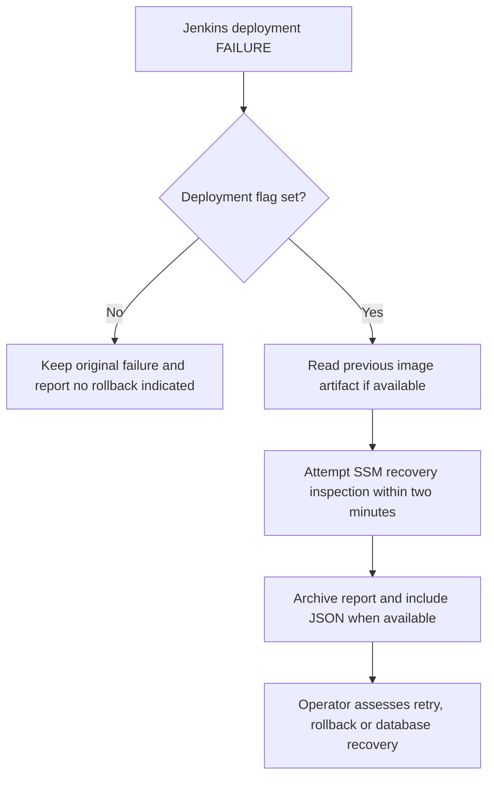

# Deployment Failure and Recovery

[Back to the main README](../README.md) · [Jenkins Operations](jenkins.md) ·
[Backup and Restore](backup-and-restore.md)

## Recovery Objectives

Confirm the actual host, image, and database state before another mutation.
Preserve the last usable backup and prefer a compatible image rollback when
the database can safely remain in place. The single-EC2 design has no
automatic failover, point-in-time recovery, or measured RPO and RTO.
Recovery preserves operator control over database changes.

## Deployment Failure Diagnostics

The deployment pipeline sets `DEPLOYMENT_STARTED=true` immediately before
the potentially modifying Ansible step. The flag indicates that the stage
began. Successful mutation of EC2 requires separate evidence.



Before deployment starts, the failure handler logs the original failure path
and reports that no application rollback is indicated. It skips inspection and
does not generate a new recovery-state artifact. Invalidate any stale workspace
output before interpreting the current build.

After deployment begins, the failure handler reads `previous-image.txt` if
available, clears old recovery JSON, then calls
[`inspect_recovery.yml`](../ansible/playbooks/inspect_recovery.yml) with a
two-minute timeout and exception handling. It attempts to write and archive
`recovery-report.txt` and includes `recovery-state.json` when inspection
produces it. The separate rollback pipeline logs a failure message and does
not run this diagnostic workflow.

| Artifact | Interpretation |
| --- | --- |
| `previous-image.txt` | Digest-pinned image reference recorded before the change. It does not contain old configuration files, database data, or an image copy |
| `recovery-state.json` | `container_exists`, `image`, `running`, `health`, and `readiness_status` observed through Ansible. The playbook writes it on the control node if `WORKSPACE` is set |
| `recovery-report.txt` | Job/build, requested SHA and digest, previous image, observed state or `NOT VERIFIED`, inspection error, and operator actions |

The inspection treats any nonzero `docker inspect` exit as
`container_exists=false`. Confirm whether the container is genuinely absent
or Docker, permissions, or inspection failed. A missing health state becomes
`UNKNOWN` and missing readiness uses `-1`. A stopped container, failed
readiness probe, or a missing report each require independent investigation.

The handler is tied to Jenkins `post failure`. For an aborted build, global
timeout, controller disruption, or lost agent, the handler or archive step
may never run. The operator should inspect EC2 independently when evidence
is missing. Keep artifacts and logs restricted.

## Operator Decision Guide

| Observation | Next step |
| --- | --- |
| Unknown release or failed pre-deployment check | Fix the input or failing dependency. Confirm the stage stopped before the application change and retry only after review |
| Intended digest active, running, healthy, and ready | Review the failing step and confirm live application state before considering another change |
| Wrong digest, unhealthy or stopped API | Confirm the live digest, migration compatibility, and backup availability. Evaluate controlled rollback |
| API container reported absent or inspection inconclusive | Check Docker and the host over SSM. The rollback guard requires an inspectable current image. Follow the authorized manual runbook if the guard cannot be satisfied |
| PostgreSQL unavailable | Investigate database, container, and volume health. Image rollback does not repair PostgreSQL or revert migrations |
| SSM unavailable or AWS session expired | Restore authorized access, renew the source session if necessary, then recheck state before deciding |
| Target digest missing from ECR | Find a verified available release and repeat compatibility review. Do not substitute an arbitrary tag |
| Schema compatibility uncertain | Stop the image rollback and review migration history, the prior application’s expectations, and restore options |

Use the [Ansible control node](deployment.md#ansible-control-node) for an
operator-run diagnostic. The playbook inspects runtime state through SSM. On a
normal WSL shell it prints the summary without creating the Jenkins JSON
artifact.

```bash
ansible-playbook -i ansible/Inventory/hosts.yml ansible/playbooks/inspect_recovery.yml
```

## Controlled Image Rollback

1. Confirm the actual EC2 image digest and its corresponding release commit.
   Compare it with the previous-image reference and published immutable tags.
2. Confirm that the target image exists in ECR, the target commit is an
   ancestor in `main`, and the application and database are compatible.
   Identify the pre-change backup before starting.
3. Review the [rollback job and current source caveat](jenkins.md#controlled-rollback).
   If the guard or current pipeline fails, keep the evidence and coordinate
   the authorized [manual alternative](deployment.md#deploy-ticket-api).
4. In `ticket-api-rollback`, supply the verified `CURRENT_SHA` and
   `ROLLBACK_SHA`. Review the evidence and approve the change if appropriate.
   The job creates another PostgreSQL backup and rechecks the current image.
5. Confirm the resulting image digest, container health, loopback readiness,
   and public HTTPS behavior. Record observed results and backup references.

Coordinate all manual operations with Jenkins operators. Jenkins locking
does not cover WSL commands. The operator decides when rollback is needed.
The deployment pipeline gathers evidence and never starts the rollback job.

## Database Recovery

An image rollback preserves PostgreSQL data and Alembic history. If a failed
release changed the schema or data, review migration status, available
backups, and the risk of losing writes made after the dump. Recover first into
an [isolated PostgreSQL container](backup-and-restore.md#isolated-restore-drill).
Production data recovery requires an approved recovery plan with preserved
evidence, explicit coordination of writers, and post-restore checks. The
repository contains neither an automated database restore nor a migration
reversal procedure.

Recovery and restore test evidence is listed in
[Testing and Validation](testing.md#operator-verified-delivery-evidence).
