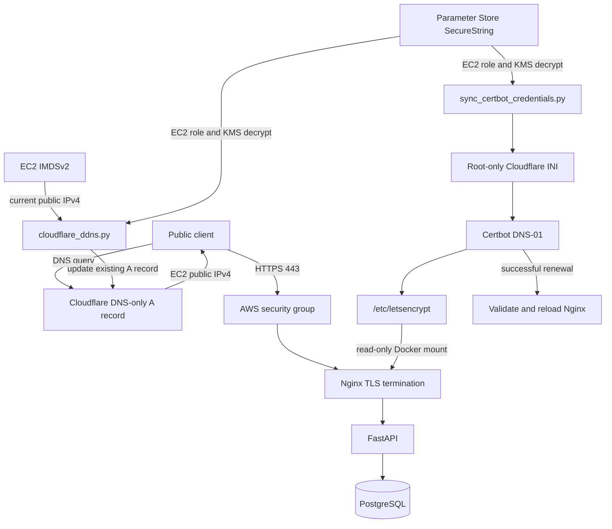

# HTTPS and Dynamic DNS Operations

[Back to the main README](../README.md)

This runbook documents the implemented public HTTPS and Cloudflare dynamic-DNS
workflow for Ticket-API. It covers the single-EC2 development deployment; it
does not describe a highly available or fully managed production ingress.

## Current Status

- Public hostname: `api.orlandoalvarez.dev`
- Cloudflare record: A record in DNS-only mode
- Public ingress: TCP 443 directly to EC2
- TLS termination: Nginx in Docker
- Certificate authority: Let's Encrypt
- ACME validation: Cloudflare DNS-01 through Certbot
- Address synchronization: Python and a systemd timer
- Administration: AWS Systems Manager, not SSH
- Load balancer: not implemented
- Elastic IP: not allocated

Public Swagger, database readiness, simulated certificate renewal, the Nginx
deploy hook, and both systemd timers have been manually verified. These checks
are operator-run evidence, not GitHub Actions jobs or high-availability tests.

## Architecture



Cloudflare resolves the hostname but does not proxy application traffic.
Clients connect directly to the EC2 public address. Nginx, not Cloudflare,
presents the Let's Encrypt certificate.

## Repository Components

| Component | Purpose |
| --- | --- |
| `ansible/files/cloudflare_ddns.py` | Reads IMDSv2, retrieves the DDNS token, and synchronizes the A record |
| `ansible/playbooks/setup_cloudflare_ddns.yml` | Installs the DDNS script, service, and timer |
| `ansible/templates/ticket-api-ddns.service.j2` | Runs the DDNS update as a root oneshot service |
| `ansible/files/ticket-api-ddns.timer` | Starts after two minutes and repeats every five minutes |
| `ansible/files/sync_certbot_credentials.py` | Atomically writes the root-only Certbot credentials file |
| `ansible/playbooks/setup_certbot.yml` | Installs Python 3.11, Certbot, and the Cloudflare plugin in a virtual environment |
| `ansible/playbooks/setup_certbot_credentials.yml` | Retrieves and validates Certbot credentials through the EC2 role |
| `ansible/playbooks/setup_certbot_renewal.yml` | Installs the Nginx deploy hook and renewal service/timer |
| `ansible/files/ticket-api-certbot-renew.timer` | Runs five minutes after boot and then every 12 hours |
| `ansible/files/reload_ticket_api_nginx.sh` | Runs `nginx -t` and reloads the running container |
| `nginx/aws-https.conf` | Defines loopback HTTP readiness and public HTTPS proxying |
| `compose.aws.yaml` | Publishes 443 and mounts the Nginx configuration and certificate directory |

## Secret and IAM Model

The EC2 inline policy permits reads for four project parameters and KMS
decryption through the regional SSM service. The HTTPS/DDNS parameters are:

- `/ticket-api/dev/cloudflare-ddns-token`
- `/ticket-api/dev/cloudflare-certbot-token`

Both must be `SecureString` values encrypted with the project KMS key. Boto3
uses the EC2 instance role; no AWS access key is stored on the host.

The DDNS token is retrieved for each run and is not persisted. The Certbot
token is synchronized to `/etc/ticket-api/cloudflare-certbot.ini`; its parent
directory is mode `0700` and the file is mode `0600`. The two Cloudflare tokens
should be separately scoped to the required zone and operation. Certbot's token
must be able to create and remove DNS challenge records.

Never print parameter values, enable shell tracing around secret operations, or
copy the credentials file into logs, tickets, screenshots, or the repository.

## Dynamic DNS Flow

`cloudflare_ddns.py` performs the following sequence:

1. Requests a short-lived IMDSv2 token without using a configured proxy.
2. Reads and validates the instance's global public IPv4 address.
3. Retrieves the DDNS token from Parameter Store with `WithDecryption=True`.
4. Requires exactly one matching A record for `api.orlandoalvarez.dev`.
5. Refuses to operate if that record is proxied instead of DNS-only.
6. Returns without writing when the address already matches.
7. Reports the proposed change when run without `--apply`.
8. Patches the record and validates the returned address when `--apply` is
   present.

The systemd service uses `--apply`. Its timer runs two minutes after boot and
every five minutes after the previous activation.

## Certificate and Renewal Flow

Certbot runs in `/opt/ticket-api/.venv-certbot` and uses the Cloudflare DNS
plugin. DNS-01 creates a temporary TXT record, so public port 80 is not needed.

The renewal timer starts five minutes after boot and repeats 12 hours after the
previous run completes. The oneshot service:

1. Synchronizes the Certbot token from Parameter Store.
2. Runs non-interactive renewal for `api.orlandoalvarez.dev`.
3. Runs `/usr/local/sbin/reload-ticket-api-nginx` only after a successful
   certificate renewal.
4. Validates Nginx configuration inside `ticket-api-nginx` before reloading.
5. Exits successfully without a reload when Nginx is stopped; the next
   container start will read the renewed files.

The repository automates renewal, not initial issuance.

## Existing-Host Setup Sequence

The current automation assumes an EC2 host that was already deployed and has
`/opt/ticket-api/.venv-secrets`. It is not a complete clean-host HTTPS
bootstrap: the HTTPS Nginx container requires an existing certificate, while
the credentials playbook reuses the environment created by application
deployment.

The Jenkins release preflight requires a ready API and an existing pinned
image. Use the authorized [host setup procedure](deployment.md#configure-the-ec2-host)
when bootstrapping or rebuilding EC2. Routine image delivery reuses the
certificate mount. DDNS and renewal remain host-side systemd services.

Run Ansible from Ubuntu WSL at the repository root. Use placeholders and keep
the Cloudflare tokens in Parameter Store rather than shell variables.

### 1. Configure DDNS

```bash
export AWS_PROFILE=ticketapi-dev

ansible-playbook \
  -i ansible/Inventory/hosts.yml \
  ansible/playbooks/setup_cloudflare_ddns.yml \
  -e "cloudflare_zone_id=<32-hex-character-zone-id>"
```

The zone ID is an infrastructure identifier, not the API token. Do not replace
the token parameter with an Ansible variable.

### 2. Install Certbot and Synchronize Its Credentials

```bash
ansible-playbook \
  -i ansible/Inventory/hosts.yml \
  ansible/playbooks/setup_certbot.yml

ansible-playbook \
  -i ansible/Inventory/hosts.yml \
  ansible/playbooks/setup_certbot_credentials.yml
```

### 3. Issue the Initial Certificate on EC2

Open an AWS Systems Manager session from Windows PowerShell:

```powershell
aws ssm start-session `
  --target "<ec2-instance-id>" `
  --region "us-west-2" `
  --profile "ticketapi-dev"
```

Then run on EC2:

```bash
sudo /opt/ticket-api/.venv-certbot/bin/certbot certonly \
  --dns-cloudflare \
  --dns-cloudflare-credentials /etc/ticket-api/cloudflare-certbot.ini \
  --dns-cloudflare-propagation-seconds 60 \
  --non-interactive \
  --agree-tos \
  --email "<operations-email>" \
  --cert-name api.orlandoalvarez.dev \
  -d api.orlandoalvarez.dev
```

This creates the renewal configuration required by
`setup_certbot_renewal.yml`. Do not manually edit files under
`/etc/letsencrypt/renewal/`.

### 4. Deploy the HTTPS Compose Configuration

From Ubuntu WSL, use the already published image digest:

```bash
export IMAGE_DIGEST="sha256:<64-hex-character-digest>"

ansible-playbook \
  -i ansible/Inventory/hosts.yml \
  ansible/playbooks/deploy_app.yml \
  -e "image_digest=${IMAGE_DIGEST}"
```

The Terraform security-group rule for public TCP 443 and the four-parameter EC2
read policy must already be applied. See
[AWS Infrastructure](aws-infrastructure.md) for the Terraform boundary.

### 5. Enable Automated Renewal

```bash
ansible-playbook \
  -i ansible/Inventory/hosts.yml \
  ansible/playbooks/setup_certbot_renewal.yml
```

The playbook refuses to enable renewal until
`/etc/letsencrypt/renewal/api.orlandoalvarez.dev.conf` exists.

## Verification Commands

### Windows PowerShell

```powershell
Resolve-DnsName api.orlandoalvarez.dev -Type A

curl.exe --fail --silent --show-error `
  https://api.orlandoalvarez.dev/api/v1/health/ready

curl.exe --request GET --silent --show-error --output NUL `
  --write-out "swagger=%{http_code}`n" `
  https://api.orlandoalvarez.dev/docs
```

### Ubuntu WSL

```bash
dig +short A api.orlandoalvarez.dev
curl --fail --silent --show-error \
  https://api.orlandoalvarez.dev/api/v1/health/ready

openssl s_client \
  -connect api.orlandoalvarez.dev:443 \
  -servername api.orlandoalvarez.dev </dev/null 2>/dev/null |
  openssl x509 -noout -subject -issuer -dates
```

### EC2 Through Systems Manager

Inspect status without printing credentials:

```bash
sudo systemctl status ticket-api-ddns.service --no-pager
sudo systemctl status ticket-api-ddns.timer --no-pager
sudo systemctl status ticket-api-certbot-renew.timer --no-pager

sudo systemctl list-timers \
  ticket-api-ddns.timer \
  ticket-api-certbot-renew.timer

sudo stat -c '%U:%G %a %n' \
  /etc/ticket-api \
  /etc/ticket-api/cloudflare-certbot.ini
```

Run a DDNS dry run; omitting `--apply` prevents a write:

```bash
sudo /opt/ticket-api/.venv-secrets/bin/python \
  /opt/ticket-api/cloudflare_ddns.py \
  --zone-id "<32-hex-character-zone-id>"
```

Test renewal through the Let's Encrypt staging environment and run the deploy
hook only after that test succeeds:

```bash
sudo /opt/ticket-api/.venv-certbot/bin/certbot renew \
  --cert-name api.orlandoalvarez.dev \
  --dry-run \
  --deploy-hook /usr/local/sbin/reload-ticket-api-nginx \
  --run-deploy-hooks
```

Certbot's `--dry-run` does not run deploy hooks unless
`--run-deploy-hooks` is provided. The explicit `--deploy-hook` matches the
systemd renewal service.

Validate Nginx independently:

```bash
sudo docker exec ticket-api-nginx nginx -t
sudo /usr/local/sbin/reload-ticket-api-nginx
sudo docker logs --tail 100 ticket-api-nginx
```

## When the EC2 Public IP Changes

1. Wait for the five-minute DDNS interval and DNS cache expiration.
2. If faster recovery is needed, start the oneshot service manually:

   ```bash
   sudo systemctl start ticket-api-ddns.service
   ```

3. Inspect the result without exposing the token:

   ```bash
   sudo systemctl status ticket-api-ddns.service --no-pager
   sudo journalctl -u ticket-api-ddns.service -n 50 --no-pager
   ```

4. Resolve the hostname from a separate client and confirm public HTTPS.

The certificate remains valid because it identifies the hostname, not the EC2
address. Do not reissue it only because the IP changed.

## DNS Troubleshooting

1. Confirm the instance has a global public IPv4 address and that IMDSv2 is
   reachable from the host.
2. Run the DDNS script without `--apply` to preserve the current record.
3. Confirm exactly one A record exists for the hostname and that it is
   DNS-only.
4. Inspect the systemd journal for sanitized failure messages.
5. Verify the parameter metadata, KMS key state, EC2 role attachment, and
   Cloudflare token scope without retrieving or printing the value.
6. Check outbound HTTPS connectivity to AWS and Cloudflare.

The script intentionally fails on missing, duplicate, malformed, or proxied
records rather than guessing which record to modify.

## Certificate-Renewal Troubleshooting

1. Confirm the renewal configuration and certificate lineage exist:

   ```bash
   sudo /opt/ticket-api/.venv-certbot/bin/certbot certificates
   sudo test -f \
     /etc/letsencrypt/renewal/api.orlandoalvarez.dev.conf
   ```

2. Check credentials metadata with `stat`; never display the file.
3. Inspect the renewal service and journal:

   ```bash
   sudo systemctl status ticket-api-certbot-renew.service --no-pager
   sudo journalctl -u ticket-api-certbot-renew.service -n 100 --no-pager
   ```

4. Run the documented dry run.
5. Confirm the Cloudflare token can manage DNS challenge records for the zone.
6. Run the reload hook independently if renewal succeeded but Nginx did not
   reload.

Do not repeatedly force production issuance while diagnosing a failure;
Let's Encrypt applies rate limits.

## Nginx Troubleshooting

1. Confirm the certificate and key paths exist without displaying their
   contents.
2. Validate the running configuration with `nginx -t`.
3. Inspect `docker compose ps` and the Nginx container logs.
4. Confirm `/etc/letsencrypt` is mounted read-only and
   `nginx/aws-https.conf` is the active container configuration.
5. Confirm host TCP 443 is listening and the security-group rule is applied.
6. Use the loopback readiness endpoint to separate application/database
   health from public DNS or TLS problems:

   ```bash
   curl --fail --silent --show-error \
     http://127.0.0.1:8080/api/v1/health/ready
   ```

The loopback HTTP server returns `404` for Swagger and normal API paths by
design.

## Manual Cloudflare Token Rotation

Rotate the DDNS and Certbot tokens independently:

1. Create a replacement Cloudflare API token scoped to the required zone and
   DNS operation.
2. Update the matching Parameter Store `SecureString` through the AWS console
   or an approved secret-input workflow, using the existing project KMS key.
   Do not place the token in shell history or command examples.
3. For DDNS, start `ticket-api-ddns.service`; the next run retrieves the new
   value directly.
4. For Certbot, rerun `setup_certbot_credentials.yml` or start the renewal
   service so the protected INI file is synchronized.
5. Run a DDNS dry run or Certbot renewal dry run, as appropriate.
6. Revoke the previous Cloudflare token only after the replacement succeeds.

Changing the Cloudflare token does not require reissuing a valid certificate.

## Risks, Limitations, and Cost Considerations

- One EC2 instance is the origin, TLS endpoint, database host, and automation
  host; there is no failover or high availability.
- The DNS-only record exposes the origin address and does not provide
  Cloudflare proxy, WAF, CDN, or DDoS-layer features.
- A changing EC2 address can cause temporary DNS inconsistency.
- The certificate private key and a protected Certbot token copy reside on the
  host and are accessible to root.
- Initial certificate issuance and clean-host ordering are not fully
  automated.
- DDNS and renewal depend on outbound network access, AWS APIs, KMS, Parameter
  Store, Cloudflare, and Let's Encrypt.
- EC2, EBS, public IPv4, KMS, S3, data transfer, domain registration, and the
  selected Cloudflare plan may incur charges. Pricing changes over time.
- Let's Encrypt does not charge for certificate issuance, but rate limits and
  operational responsibilities still apply.

For plugin options and renewal-hook behavior, consult the official
[Certbot Cloudflare plugin documentation](https://certbot-dns-cloudflare.readthedocs.io/en/stable/)
and [Certbot renewal documentation](https://eff-certbot.readthedocs.io/en/stable/using.html#renewing-certificates).
