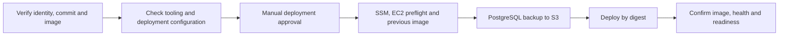
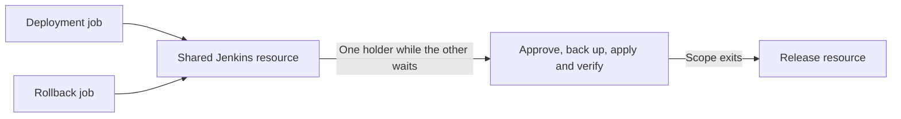

# Jenkins Operations

[Back to the main README](../README.md) · [CI and Delivery](ci-cd.md)

## Controller and Agent

The operator runs the `ticket-api-jenkins` controller locally with
`jenkins/jenkins:lts-jdk21` at <http://localhost:18081>. Its inbound Docker
agent, `ticket-api-cd-agent`, joins the shared Docker network over WebSocket.
The controller home and agent workspace use persistent Docker volumes.
Controller startup, plugin installation, node registration, and credentials
are configured in the operator environment.

Build the agent for Linux x86-64 from the repository root.

```bash
docker build --platform linux/amd64 -t ticket-api-cd-agent:dev -f jenkins/agent/Dockerfile .
```

The [agent Dockerfile](../jenkins/agent/Dockerfile) extends
`jenkins/inbound-agent:jdk21`, installs Git, AWS CLI v2 and the Session
Manager Plugin, and runs as the `jenkins` user. It installs Ansible Core,
Boto3, and Botocore with CRT support in `/opt/ansible` and installs the
`amazon.aws` and `community.docker` collections. Register the inbound node
with label `ticket-api-cd`. The controller needs Jenkins Pipeline, Git, and
Lockable Resources support.

Both jobs set `AWS_PROFILE=ticketapi-jenkins`, `AWS_DEFAULT_REGION=us-west-2`,
and `ECR_REPOSITORY=ticket-api`. The profile assumes the expected
`ticket-api-dev-jenkins-deployer` role from an interactive temporary
development session. The agent can potentially access the source credentials.
Keep it restricted to trusted SCM and approved operators. See
[Security](security.md#jenkins-execution-identity).

## Pipeline Definitions and Syntax Checks

Use **Pipeline script from SCM** with Git and a trusted branch containing the
pipeline definitions and Ansible files. Ensure the checkout can fetch
`origin/main` and contains the history needed for ancestry checks.

| Operator job | Case-sensitive Script Path | Parameters |
| --- | --- | --- |
| `ticket-api-cd-deployment` | [Jenkinsfile](../Jenkinsfile) | `RELEASE_SHA` |
| `ticket-api-rollback` | [Jenkinsfile.rollback](../Jenkinsfile.rollback) | `CURRENT_SHA` and `ROLLBACK_SHA` |

`ticket-api-cd-scm-test` was an earlier operator job. Job names live in Jenkins.
The filenames above live in Git. For edits before commit, use the Declarative
Pipeline linter in [Testing](testing.md#jenkins-pipeline-validation).
Pasting either current pipeline into **Pipeline script** and running it can
reach production operations after approval and also requires a suitable
workspace. Use the linter for syntax-only checks.

## Deployment Pipeline

| Stage | Gate or action |
| --- | --- |
| Verify AWS Identity | Calls STS with the case-sensitive `Arn` field and checks the expected assumed-role ARN. |
| Resolve Release Image | Trims and validates `RELEASE_SHA` as 40 lowercase hexadecimal characters, queries the exact `sha-<commit>` tag, and validates the `sha256:<64 lowercase hex>` digest. |
| Verify Release Commit | Fetches the remote `main` ref, verifies the object is a commit, and checks that it is reachable from `origin/main`. |
| Verify Deployment Tooling | Checks AWS CLI, Ansible, Session Manager Plugin, and STS identity. |
| Verify Ansible Inventory | Displays the host entry and resolved SSM profile for `ticket-api-ec2`. |
| Validate Deployment Playbook | Runs an Ansible syntax check for `deploy_app.yml` with the release digest. |
| Approve Deployment | Shows the commit, digest, backup, and migration implications. Restricts approval to `Admin` and records the approver. |
| Verify SSM Connectivity | Runs a hostname check on EC2 through Ansible. |
| Verify EC2 Deployment Prerequisites | Checks privileges, Docker and Compose, current API readiness, and the current digest-pinned image. Archives `previous-image.txt` with fingerprinting. |
| Verify Rollback Image | Checks the previous digest format and expected repository, then queries ECR by digest. |
| Backup PostgreSQL | Runs `backup_postgres.yml` and requires upload verification to succeed. |
| Deploy Ticket-API | Sets `DEPLOYMENT_STARTED=true` before invoking `deploy_app.yml` with the release digest. |
| Verify Deployment | Runs `verify_deployment.yml` to check the image reference, running and healthy state, and database-backed HTTP readiness. |



The deployment preflight assumes a working installation with a healthy API
readiness endpoint and a current pinned image. Use the
[deployment runbook](deployment.md) for initial host setup. The `post failure`
hook handles diagnostic evidence as described in
[Disaster Recovery](disaster-recovery.md#deployment-failure-diagnostics).

## Controlled Rollback

Use `CURRENT_SHA` for the version you expect to be on EC2 now. Use
`ROLLBACK_SHA` for the previously published target. Both must be different
full 40-character lowercase hexadecimal commit SHAs.

| Stage | Gate or action |
| --- | --- |
| Validate Parameters | Validates both SHAs and rejects identical input. |
| Verify AWS Identity | Checks the expected STS assumed role. |
| Verify Release History | Fetches `main`, checks that both commits are in `origin/main`, and requires the target to be an ancestor of the expected current release. |
| Verify Rollback Compatibility | Requires no differences in `app/`, `alembic/`, `docker-compose.yml`, `compose.prod.yaml`, or `compose.aws.yaml`. |
| Resolve ECR Images | Resolves both exact commit tags and rejects malformed or identical digests. |
| Verify Current EC2 Release | Runs rollback preflight, compares the observed image with the expected digest, and archives `previous-image.txt`. |
| Approve Rollback | Requests operator approval with both SHAs and explains the database boundary. |
| Backup PostgreSQL | Creates and verifies a pre-change S3 backup. |
| Recheck Current Release | Repeats preflight and rechecks the current image after backup. |
| Rollback Ticket-API | Runs `deploy_app.yml` with the target digest. |
| Verify Rollback | Checks the target image, container health, and readiness using `verify_deployment.yml`. |

```mermaid
flowchart LR
    Candidate[Validate both SHAs and ancestry] --> Compare[Check selected paths and ECR digests]
    Compare --> Live[Match current EC2 digest]
    Live --> Approve[Manual rollback approval]
    Approve --> Backup[Back up PostgreSQL]
    Backup --> Recheck[Match current EC2 digest again]
    Recheck --> Restore[Deploy target image]
    Restore --> Verify[Verify digest, health and readiness]
```



The path comparison is conservative. Differences in those paths require
manual compatibility review. It omits `Dockerfile`, `pyproject.toml`,
`alembic.ini`, `nginx/`, `ansible/`, and pipeline definitions. It also does
not establish runtime database state or backward compatibility. The playbook
may run the migration service as it normally does. Recovery by image
preserves the live PostgreSQL data and does not reverse schema migrations.
The rollback preflight can inspect an unhealthy or stopped API when Docker,
the container image reference, and PostgreSQL remain available.

The [current rollback source](../Jenkinsfile.rollback) has a blank line
after the inventory continuation in `Verify Current EC2 Release`.
This splits the command before the playbook argument. Treat the
operator-reported successful rollback as historical evidence. Review the
initial command before relying on this checkout and confirm the corrected
command in a controlled test. A rollback failure logs an investigation
message and does not run the deployment job's diagnostic hook.

## Timeouts and Locking

| Check | Deployment | Rollback |
| --- | --- | --- |
| Pipeline | 30 minutes | 30 minutes |
| Approval | 5 minutes, `Admin` restriction | Within the global timeout. Approval access depends on Jenkins policy |
| SSM connectivity and deployment prerequisites | 3 minutes each | No separate timeout for rollback preflight or recheck |
| Backup | 4 minutes | 4 minutes |
| Apply image | 10 minutes | 10 minutes |
| Final verification | 3 minutes | 3 minutes |
| Failure inspection | 2 minutes when the failure handler reaches the inspection step | No corresponding inspection hook |

`disableConcurrentBuilds()` serializes builds of each job. The Lockable
Resources plugin coordinates both jobs through `ticket-api-ec2-deployment`.
The pipeline waits while another job holds the resource. Jenkins releases it
when the lock scope ends, including after failure under normal controller
operation. The lock covers approvals and protected runtime operations. Avoid
synchronously waiting for a rollback job while holding the same resource.
The lock applies to jobs on the same controller. WSL and external automation
can still change EC2.



## Troubleshooting and Evidence

| Symptom | Check |
| --- | --- |
| Job waits before stages | Check the `ticket-api-cd` label, WebSocket connection, executor, and shared lock holder. |
| Profile missing or session expired | Confirm `ticketapi-jenkins` in the agent's execution context and renew the temporary source session through the operator procedure. |
| STS identity mismatch or `AccessDenied` | Check the exact `Arn` selector, expected assumed role, source session, relevant policy and boundary. |
| ECR lookup fails | Check the region, image tag, Git history, and ECR permissions. An unknown tag can fail before approval or backup. |
| SSM connection fails | Check the inventory profile, instance management status, Session Manager Plugin and scoped SSM and transfer-bucket permissions. |
| Backup or verification fails | Review the failed stage and AWS or Ansible error. Follow the [recovery runbook](disaster-recovery.md) before retrying. |

Keep console output and downloadable artifacts restricted. Image references,
account metadata, infrastructure locations, and error details can appear in
logs. `previous-image.txt` records a digest-pinned image reference. It contains
neither PostgreSQL data nor the prior deployment configuration. Artifacts
`recovery-report.txt` and `recovery-state.json` are discussed in the recovery
runbook. See [operator-reported evidence](testing.md#operator-verified-delivery-evidence)
for the tested release and failure scenarios.
